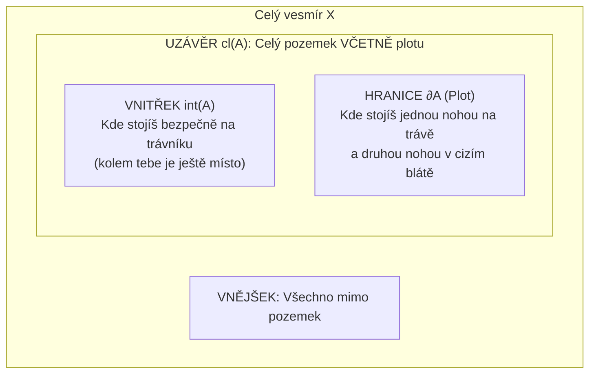
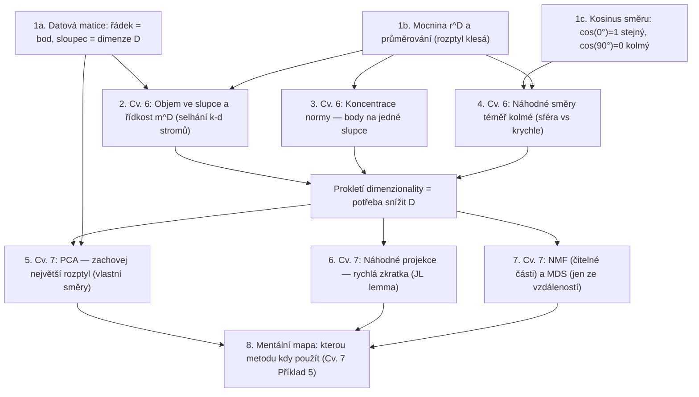

# 🎓 CVIČENÍ 5 & 6: TOPOLOGIE & GEOMETRIE VYSOKÝCH DIMENZÍ (TABULE)

> *"Topologie zkoumá prostor bez pravítka (vnitřek, hranici, souvislost). Geometrie vysokých dimenzí naopak ukazuje, jak se naše intuice z 2D a 3D hroutí, když dimenze vystřelí k nekonečnu: veškerá hmota se vytlačí na povrch, koule má objem nula a náhodné vektory jsou na sebe kolmé."*

---

## 📌 MASTER ROADMAPA CVIČENÍ & PROGRESS TRACKING

### 🟢 Část I: Cvičení 5 – Topologie a metrické prostory
| Blok / Příklad | Téma & Klíčové koncepty | Stav | Rychlý skok |
| :---: | :--- | :---: | :---: |
| **Blok 1 (Příklad 1)** | **Eukleidovský prostor na $\mathbb{R}$** • $\operatorname{int}$, $\operatorname{cl}$, $\partial$ • Hromadné body $A'$ vs. izolované body $\operatorname{Iso}(A)$ • Interval $(0, 2] \cup \{4\}$ vs. racionální čísla $\mathbb{Q} \cap [0, 1]$ | 🔄 *Aktivní* | [Přejít na řešení](#-příklad-1-eukleidovský-prostor-mathbbr-d_2) |
| **Blok 2 (Příklad 2)** | **Konečný topologický prostor $(X, \tau)$** • Uzavřené množiny $\mathcal{F} = \{X \setminus U\}$ • $\operatorname{int}$, $\operatorname{cl}$, $\partial$ v libovolné topologii • Minimální báze $\mathcal{B}$ (nerozložitelné otevřené množiny) • Souvislost prostoru (clopen množiny) | ⏳ *Čeká* | [Přejít na řešení](#-příklad-2-konečný-topologický-prostor) |
| **Blok 3 (Příklad 3)** | **Pawlakova topologie & Rough Sets** • Rozklad $U/R$ jako báze $\mathcal{B}_R$ • Dolní aproximace $\underline{R}(A) = \operatorname{int}(A)$ (100% jistota) • Horní aproximace $\overline{R}(A) = \operatorname{cl}(A)$ (možnost) • Oblast nejistoty $\operatorname{BN}_R(A) = \partial A$ • Proč Pawlak není $T_0$ ani metrizovatelný | ⏳ *Čeká* | [Přejít na řešení](#-příklad-3-pawlakova-topologie) |
| **Blok 4 (Příklad 4)** | **Oddělovací axiomy ($T_0, T_1, T_2$) & Metrizovatelnost** • Hierarchie: $T_2 \implies T_1 \implies $T_0$ • $T_1 \iff$ jednobodové množiny jsou uzavřené • $T_2 \iff$ disjunktní okolí (Hausdorff) • Analýza: Indiskrétní, Sierpińského a Kofinitní prostor | ⏳ *Čeká* | [Přejít na řešení](#-příklad-4-oddělovací-axiomy-t_0-t_1-t_2-a-metrizovatelnost) |
| **Blok 5 (Příklad 5)** | **Spojitá zobrazení mezi topologiemi** • Podmínka: $\forall V \in \tau_Y : f^{-1}(V) \in \tau_X$ • Zobrazení na konečných množinách • Diskrétní topologie: z diskrétního vs. do diskrétního | ⏳ *Čeká* | [Přejít na řešení](#-příklad-5-spojité-zobrazení-f--x-tau_x-to-y-tau_y) |

---

### 🟣 Část II: Cvičení 6 – Geometrie vysokých dimenzí & Prokletí dimenzionality
| Blok / Příklad | Téma & Klíčové koncepty | Stav | Rychlý skok |
| :---: | :--- | :---: | :---: |
| **Blok 6 (Příklad 1)** | **Objem hyperkoule $K_D(r)$ vs. hyperkrychle $C_D(r)$** • Vzorec s Gama funkcí $\Gamma$, $\lim_{D \to \infty} V(K_D(r)) = 0$ • Koncentrace objemu ve slupce: poměr $(1 - \varepsilon)^D \to 0$ • Proč koule tvoří 0 % opsané krychle a rohy krychle trčí do dálky | ⏳ *Čeká* | [Přejít na teorii & řešení](#-cvičení-6-geometrie-vysokých-dimenzí-teorie--řešení) |
| **Blok 7 (Příklad 2)** | **Shell Phenomenon & Koncentrace normy** • Náhodný vektor $x \in \mathbb{R}^D$ s i.i.d. složkami • Střední hodnota a rozptyl $\frac{1}{D}\|x\|_2^2$, zákon velkých čísel • Typická vzdálenost roste jako $\sqrt{D}$ (body v tenké slupce) • Jednotková krychle $[0, 1]^D$ vs. jednotková sféra $S^{D-1}$ | ⏳ *Čeká* | [Přejít na Příklad 2 Cv6](#-příklad-2-cv6-shell-phenomenon--koncentrace-normy) |
| **Blok 8 (Příklad 3)** | **Ortogonalita náhodných směrů ve vysokých dimenzích** • Kosinová podobnost na sféře $S^{D-1}$: $\mathbb{E}[\cos \theta] = 0, \operatorname{Var} = 1/D$ • $\lim_{D \to \infty} \cos \theta = 0 \implies \theta \to 90^\circ$ (téměř jistá kolmost) • Odlišné chování v kladném ortantu krychle $[0, 1]^D$ ($\cos \theta \to 3/4$) • Dopady na reprezentaci dat (HDC vs. selhání metrik) | ⏳ *Čeká* | [Přejít na Příklad 3 Cv6](#-příklad-3-cv6-ortogonalita-náhodných-směrů) |
| **Blok 9 (Příklad 4)** | **Řídkost prostoru & Selhání prostorových stromů (k-d stromy)** • Exponenciální exploze buněk: $m^D = 5^{20} \approx 9.54 \times 10^{13}$ • Průměrná zaplněnost pro $N = 10\,000$ bodů ($\approx 10^{-10}$) • Proč k-d stromy selhávají při hledání sousedů (degradace na $O(N)$) | ⏳ *Čeká* | [Přejít na Příklad 4 Cv6](#-příklad-4-cv6-řídkost-prostoru--k-d-stromy) |

---

## 🟢 KAPITOLA 0: CO TO SAKRA JE TOPOLOGIE? (ZCELA OD NULY)

Pokud ti vzorce připadají jako cizí jazyk, zapomeň na chvíli na řecká písmena a představ si následující 4 obrazy ze života:

### 1. Proč zahazujeme pravítko? (Metafora gumového balónku)
V klasické matematice máme **metriku** $d(x, y)$ – to je **tuhé pravítko**. Říká přesně: bod $A$ je od bodu $B$ vzdálený $3{,}54\text{ cm}$.

Jenže představ si, že nakreslíš obrázek fixou na **nenafouknutý gumový balónek**.
Když balónek nafoukneš a různě ho natahuješ do stran:
- Všechny milimetrové vzdálenosti se úplně změní a zkroutí (pravítko je k ničemu).
- **Ale co se NIKDY nezmění?**
  1. Bod, který byl **uvnitř** nakresleného kruhu, je pořád uvnitř.
  2. Bod, který byl **na okraji (hranici)**, je pořád na okraji.
  3. Skvrna, která byla **v jednom kuse (souvislá)**, se neroztrhla na dva kusy.
  4. Dva oddělené fleky jsou pořád dva oddělené fleky.

👉 **Topologie je matematika, která zkoumá přesně tyto vlastnosti: blízkost, vnitřek, hranici a spojitost bez nutnosti cokoliv měřit na centimetry.**

---

### 2. Jak definovat "blízkost" bez pravítka? BUBLINAMI!
Když nemáme pravítko s centimetry, jak řekneme, že je něco "poblíž"?
Pomocí **otevřených množin** – představ si je jako **mýdlové bubliny**:
- Otevřená množina je zóna bez ostré tvrdé slupky. Kolem každého bodu uvnitř je ještě mikroskopický kousek volného místa.
- **Topologie $\tau$** není nic jiného než **katalog povolených bublin**, na kterých jsme se předem dohodli.

Pravidla pro katalog bublin ($\tau$) jsou jen 3 zdravorozumové zásady:
1. Prázdný prostor $\emptyset$ (žádná bublina) i celý vesmír $X$ (obří bublina) v katalogu musí být.
2. Když sliješ libovolně mnoho bublin dohromady (sjednocení $\bigcup$), vznikne zase platná bublina.
3. Když vezmeš překryv dvou bublin (konečný průnik $\bigcap$), ten překryv je pořád platná menší bublina.

---

### 3. Anatomie množiny: Pozemek, Dům a Plot
Vezměme si libovolnou množinu $A$ (třeba tvůj pozemek):

- **Vnitřek $\operatorname{int}(A)$:** Body bezpečně uvnitř. Můžeš udělat krok v libovolném směru a pořád jsi v $A$.
- **Hranice $\partial A$:** Samotný plot. V každém tvém sebemenším okolí je jak bod z $A$, tak bod mimo $A$.
- **Uzávěr $\operatorname{cl}(A)$:** Celá plocha pozemku včetně plotu: $\operatorname{cl}(A) = \operatorname{int}(A) \cup \partial A$.
- **Hromadný bod $A'$:** Místo velké tlačenice. Kolem tohoto bodu se tísní nekonečně mnoho dalších bodů z $A$ (jako mraveniště).
- **Izolovaný bod $\operatorname{Iso}(A)$:** Osamělý kaktus v poušti. Patří do $A$, ale v jeho těsné blízkosti žádný jiný bod z $A$ není.

> 💡 **Chyták s dveřmi:** V běžném životě jsou dveře buď otevřené, nebo zavřené. V topologii to NEPLATÍ! Množina může být otevřená, uzavřená, **obojí naráz (clopen)**, nebo **ani jedno** (např. interval $(0, 2]$, který má zleva díru a zprava plot).

---

### 4. Oddělovací axiomy ($T_0, T_1, T_2$): Rozlišení monitoru
Máš dva různé body $x \neq y$. Dokáže je tvoje topologie (tvoje bubliny) od sebe rozeznat?

- **Slepý prostor (Indiskrétní):** Nemáš žádné malé bubliny, jen celý vesmír. Body od sebe nerozeznáš. (Nesplňuje ani $T_0$).
- **$T_0$ (Hrubé rozlišení):** Najde se aspoň jedna bublina, která obsahuje bod $x$, ale už neobsahuje $y$.
- **$T_1$ (Ostré body):** Kolem $x$ umíš udělat bublinu bez $y$, a kolem $y$ umíš udělat bublinu bez $x$. To je přesně totéž, jako říct: **každý samostatný bod $\{x\}$ je uzavřený** (je to ostrá tečka, ne rozmazaná šmouha).
- **$T_2$ / Hausdorffův prostor (Perfektní rozlišení):** Bod $x$ zavřeš do jedné bubliny, bod $y$ do druhé, a ty dvě bubliny se **ani nedotknou** ($U \cap V = \emptyset$).

💥 **BOMBA ZKOUŠKOVÉ PRAVIDLO (Věta 5.1):**
Když máš na množině normální pravítko (metriku), vždycky můžeš udělat kolem každého bodu malou kouli o poloměru $r = \frac{1}{2} d(x, y)$ a ty koule se neprotnou!
👉 **Každý prostor s metrikou MUSÍ být $T_2$!**
Pokud prostor selže v $T_2$ (nebo dokonce v $T_0$), **JE NEMOŽNÉ na něm zavést metriku (není metrizovatelný)!**

---

### 5. Pawlakova topologie: Databáze s rozmazaným viděním (Rough Sets)
Představ si databázi pacientů. Kvůli GDPR nemáš jejich jména, znáš jen: `Pohlaví` a `Věkovou skupinu`.
Všichni lidé se stejnými údaji (např. 25letí muži) spadnou do jednoho pytle (třídy ekvivalence): $\{1, 2\}$.

Pro databázi jsou lidé $1$ a $2$ **nerozlišitelní**!
- Když se zeptáš: *"Kdo má chřipku?"* (množina $A$):
  - **Dolní aproximace $\underline{R}(A) = \operatorname{int}(A)$:** Pytle, kde mají chřipku **úplně všichni** (*100% jistota*).
  - **Horní aproximace $\overline{R}(A) = \operatorname{cl}(A)$:** Pytle, kde má chřipku **aspoň jeden člověk** (*možná ano*).
  - **Oblast nejistoty $\operatorname{BN}_R(A) = \partial A$:** $\overline{R}(A) \setminus \underline{R}(A)$ (*tam tápeme, chřipku má jen někdo*).
- **Proč Pawlak není metrizovatelný?** Protože člověka $1$ a $2$ ze stejného pytle nedokážeš žádnou bublinou oddělit – prostor nesplňuje ani $T_0$!

---

### 6. Spojité zobrazení: Netrháme látku
Kdy je funkce $f: X \to Y$ spojitá?
V analýze se říkalo: "kreslíš jedním tahem bez zvednutí tužky".
V topologii je to ještě hezčí:
Vezmi v cíli jakoukoliv pěknou bublinu $V$. Pokud se podíváš, odkud ty body přišly ($f^{-1}(V)$), musí to v původním prostoru být také platná bublina (otevřená množina).
👉 **Vzor otevřené množiny je otevřená množina.**

---

# ✍️ ŘEŠENÍ PŘÍKLADŮ ZE CVIČENÍ 5

---

## 📌 PŘÍKLAD 1: Eukleidovský prostor $(\mathbb{R}, d_2)$

Zadání:
- $A = (0, 2] \cup \{4\}$
- $B = \mathbb{Q} \cap [0, 1]$

### Množina $A = (0, 2] \cup \{4\}$:
1. **Vnitřek $\operatorname{int}(A)$:** Kde máme kolem sebe oboustranný otevřený interval? V $(0, 2)$. Bod $2$ nemá napravo nic z $A$. Bod $4$ nemá kolem sebe vůbec nic z $A$.
   $$\operatorname{int}(A) = (0, 2)$$
2. **Uzávěr $\operatorname{cl}(A)$:** Doplníme krajní body hromadění. K $(0, 2]$ přilepíme $0$. Bod $4$ už v $A$ je.
   $$\operatorname{cl}(A) = [0, 2] \cup \{4\}$$
3. **Hranice $\partial A = \operatorname{cl}(A) \setminus \operatorname{int}(A)$:**
   $$\partial A = ([0, 2] \cup \{4\}) \setminus (0, 2) = \{0, 2, 4\}$$
4. **Hromadné body $A'$:** Které body mají v každém $\varepsilon$-okolí nekonečně mnoho bodů z $A$? Celý interval $[0, 2]$. (Bod $4$ má okolí $(3.9, 4.1)$, kde leží jen on sám $\implies$ není hromadný).
   $$A' = [0, 2]$$
5. **Izolované body $\operatorname{Iso}(A) = A \setminus A'$:**
   $$\operatorname{Iso}(A) = \{4\}$$

---

### Množina $B = \mathbb{Q} \cap [0, 1]$ (racionální čísla v $[0, 1]$):
1. **Vnitřek $\operatorname{int}(B)$:** Existuje nějaký interval $(a, b)$, který by obsahoval *pouze* racionální čísla? **Ne!** Mezi libovolnými dvěma racionálními čísly leží iracionální číslo (např. s $\sqrt{2}$).
   $$\operatorname{int}(B) = \emptyset$$
2. **Uzávěr $\operatorname{cl}(B)$:** K jakým bodům se umíme racionálními čísly libovolně přiblížit? Ke všem reálným číslům v daném intervalu!
   $$\operatorname{cl}(B) = [0, 1]$$
3. **Hranice $\partial B = \operatorname{cl}(B) \setminus \operatorname{int}(B)$:**
   $$\partial B = [0, 1] \setminus \emptyset = [0, 1]$$
4. **Hromadné body $B'$:** V každém okolí libovolného bodu z $[0, 1]$ je nekonečně mnoho zlomků.
   $$B' = [0, 1]$$
5. **Izolované body $\operatorname{Iso}(B) = B \setminus B'$:**
   $$\operatorname{Iso}(B) = \emptyset$$

### 📋 Výsledná tabulka Příklad 1:
| Množina | $\operatorname{int}(\cdot)$ | $\operatorname{cl}(\cdot)$ | $\partial(\cdot)$ | Hromadné body $(\cdot)'$ | Izolované body $\operatorname{Iso}(\cdot)$ |
| :--- | :--- | :--- | :--- | :--- | :--- |
| $A = (0, 2] \cup \{4\}$ | $(0, 2)$ | $[0, 2] \cup \{4\}$ | $\{0, 2, 4\}$ | $[0, 2]$ | $\{4\}$ |
| $B = \mathbb{Q} \cap [0, 1]$ | $\emptyset$ | $[0, 1]$ | $[0, 1]$ | $[0, 1]$ | $\emptyset$ |

---

## 📌 PŘÍKLAD 2: Konečný topologický prostor

Množina $X = \{a, b, c, d\}$.
- $\tau_1 = \{\emptyset, \{a\}, \{c\}, \{a, c\}, \{a, b, c\}, X\}$
- $\tau_2 = \{\emptyset, \{a\}, \{b, c, d\}, X\}$
Podmnožiny: $M = \{b, c\}$, $N = \{a, b, c\}$.

### a) Uzavřené množiny (doplňky otevřených $X \setminus U$):
- **V $(X, \tau_1)$:**
  - $X \setminus \emptyset = X$
  - $X \setminus \{a\} = \{b, c, d\}$
  - $X \setminus \{c\} = \{a, b, d\}$
  - $X \setminus \{a, c\} = \{b, d\}$
  - $X \setminus \{a, b, c\} = \{d\}$
  - $X \setminus X = \emptyset$
  $$\mathcal{F}_1 = \{\emptyset, \{d\}, \{b, d\}, \{a, b, d\}, \{b, c, d\}, X\}$$

- **V $(X, \tau_2)$:**
  - $X \setminus \emptyset = X$
  - $X \setminus \{a\} = \{b, c, d\}$
  - $X \setminus \{b, c, d\} = \{a\}$
  - $X \setminus X = \emptyset$
  $$\mathcal{F}_2 = \{\emptyset, \{a\}, \{b, c, d\}, X\}$$
  *(Všimni si: v $\tau_2$ jsou všechny množiny otevřené i uzavřené zároveň!)*

---

### b) Určení $\operatorname{int}$, $\operatorname{cl}$, $\partial$:

#### V prostoru $(X, \tau_1)$:
- **Pro $M = \{b, c\}$:**
  - $\operatorname{int}(M)$: největší otevřená uvnitř $\{b, c\}$ $\to$ z otevřených množin $\emptyset, \{a\}, \{c\}, \{a, c\}, \{a, b, c\}, X$ se do $M$ vejde jen $\{c\}$ a $\emptyset$. Největší je $\{c\}$.
    $$\operatorname{int}(M) = \{c\}$$
  - $\operatorname{cl}(M)$: nejmenší uzavřená obalující $\{b, c\}$ $\to$ z uzavřených $\mathcal{F}_1$ obsahují $\{b, c\}$ množiny $\{b, c, d\}$ a $X$. Nejmenší je $\{b, c, d\}$.
    $$\operatorname{cl}(M) = \{b, c, d\}$$
  - $\partial M = \operatorname{cl}(M) \setminus \operatorname{int}(M) = \{b, c, d\} \setminus \{c\} = \{b, d\}$.

- **Pro $N = \{a, b, c\}$:**
  - $\operatorname{int}(N)$: $\{a, b, c\}$ je přímo v $\tau_1$ (je otevřená!), takže největší otevřená uvnitř je ona sama:
    $$\operatorname{int}(N) = \{a, b, c\} = N$$
  - $\operatorname{cl}(N)$: uzavřená nadmnožina z $\mathcal{F}_1$ obsahující $\{a, b, c\}$ je pouze celá $X$.
    $$\operatorname{cl}(N) = X = \{a, b, c, d\}$$
  - $\partial N = X \setminus \{a, b, c\} = \{d\}$.

#### V prostoru $(X, \tau_2)$:
- **Pro $M = \{b, c\}$:**
  - $\operatorname{int}(M)$: otevřené jsou $\emptyset, \{a\}, \{b, c, d\}, X$. Žádná neprázdná se do $\{b, c\}$ nevejde.
    $$\operatorname{int}(M) = \emptyset$$
  - $\operatorname{cl}(M)$: uzavřené obsahující $\{b, c\}$ jsou $\{b, c, d\}$ a $X$. Nejmenší je $\{b, c, d\}$.
    $$\operatorname{cl}(M) = \{b, c, d\}$$
  - $\partial M = \{b, c, d\} \setminus \emptyset = \{b, c, d\}$.

- **Pro $N = \{a, b, c\}$:**
  - $\operatorname{int}(N)$: z otevřených se dovnitř vejde $\{a\}$ a $\emptyset$. Největší je $\{a\}$.
    $$\operatorname{int}(N) = \{a\}$$
  - $\operatorname{cl}(N)$: z uzavřených $\emptyset, \{a\}, \{b, c, d\}, X$ obsahuje $N$ pouze $X$.
    $$\operatorname{cl}(N) = X$$
  - $\partial N = X \setminus \{a\} = \{b, c, d\}$.

### 📋 Výsledná tabulka Příklad 2 (b):
| Prostor a množina | $\operatorname{int}(\cdot)$ | $\operatorname{cl}(\cdot)$ | $\partial(\cdot)$ |
| :--- | :--- | :--- | :--- |
| $\tau_1 : M$ | $\{c\}$ | $\{b, c, d\}$ | $\{b, d\}$ |
| $\tau_1 : N$ | $\{a, b, c\}$ | $X$ | $\{d\}$ |
| $\tau_2 : M$ | $\emptyset$ | $\{b, c, d\}$ | $\{b, c, d\}$ |
| $\tau_2 : N$ | $\{a\}$ | $X$ | $\{b, c, d\}$ |

---

### c) Minimální báze:
Báze $\mathcal{B}$ je kolekce otevřených množin, ze kterých sjednocením poskládáme celou topologii. Hledáme "nerozložitelné cihly" (množiny, které nevzniknou sjednocením jiných otevřených).

- **Pro $\tau_1$:**
  - $\{a, c\} = \{a\} \cup \{c\}$ $\implies$ $\{a, c\}$ nepotřebujeme.
  - $\{a, b, c\}$ nelze složit ze žádných menších otevřených (žádná neobsahuje $b$). Musí v bázi být!
  - $X$ nelze složit ze žádných menších otevřených (žádná neobsahuje $d$). Musí v bázi být!
  - $\{a\}$ a $\{c\}$ jsou jednoprvkové nerozložitelné.
  $$\mathcal{B}_1 = \{\{a\}, \{c\}, \{a, b, c\}, X\}$$

- **Pro $\tau_2$:**
  - Množina $X = \{a\} \cup \{b, c, d\}$. Tedy $X$ vznikne sjednocením a v bázi být nemusí!
  $$\mathcal{B}_2 = \{\{a\}, \{b, c, d\}\}$$

---

### d) Souvislost prostorů:
- **$(X, \tau_1)$:** Lze $X$ rozložit na dvě neprázdné disjunktní otevřené množiny? 
  Ne, jediné otevřené jsou $\emptyset, \{a\}, \{c\}, \{a, c\}, \{a, b, c\}, X$. Žádné dvě nemají sjednocení $X$ s prázdným průnikem. Jediné clopen množiny jsou $\emptyset$ a $X$.
  $$\implies (X, \tau_1) \text{ je SOUVISLÝ}$$
- **$(X, \tau_2)$:** Máme otevřené množiny $\{a\}$ a $\{b, c, d\}$. Jsou neprázdné, disjunktní a $\{a\} \cup \{b, c, d\} = X$.
  $$\implies (X, \tau_2) \text{ je NESOUVISLÝ}$$

---

## 📌 PŘÍKLAD 3: Pawlakova topologie

$U = \{1, 2, 3, 4, 5, 6\}$, rozklad $U/R = \{\{1, 2\}, \{3, 4, 5\}, \{6\}\}$.

### a) Báze a topologie:
- **Báze $\mathcal{B}_R$:** Přímo třídy rozkladu:
  $$\mathcal{B}_R = \{\{1, 2\}, \{3, 4, 5\}, \{6\}\}$$
- **Topologie $\tau_R$:** Všechna sjednocení bázových prvků ($2^3 = 8$ množin):
  $$\tau_R = \{\emptyset, \{1, 2\}, \{3, 4, 5\}, \{6\}, \{1, 2, 3, 4, 5\}, \{1, 2, 6\}, \{3, 4, 5, 6\}, U\}$$

---

### b) Dolní, horní aproximace a hranice:
Pravidlo je jednoduché:
- **Dolní aproximace $\underline{R}(Y) = \operatorname{int}(Y)$:** Které třídy jsou **celé uvnitř** $Y$?
- **Horní aproximace $\overline{R}(Y) = \operatorname{cl}(Y)$:** Které třídy mají s $Y$ **aspoň 1 prvek společný**?
- **Hranice $\operatorname{BN}_R(Y) = \partial Y = \overline{R}(Y) \setminus \underline{R}(Y)$**.

#### Pro $A = \{2, 3, 4\}$:
- Třída $\{1, 2\}$: uvnitř je jen $2 \implies$ není celá v $A$.
- Třída $\{3, 4, 5\}$: uvnitř jsou $3, 4$, ale chybí $5 \implies$ není celá v $A$.
- Třída $\{6\}$: nemá s $A$ nic společného.
- **$\operatorname{int}(A) = \underline{R}(A) = \emptyset$**
- Které se dotýkají? $\{1, 2\}$ a $\{3, 4, 5\}$.
- **$\operatorname{cl}(A) = \overline{R}(A) = \{1, 2\} \cup \{3, 4, 5\} = \{1, 2, 3, 4, 5\}$**
- **$\partial A = \operatorname{BN}_R(A) = \{1, 2, 3, 4, 5\} \setminus \emptyset = \{1, 2, 3, 4, 5\}$**

#### Pro $B = \{1, 2, 3, 4\}$:
- Třída $\{1, 2\}$: celá leží v $B$! $\implies \{1, 2\}$
- Třída $\{3, 4, 5\}$: chybí $5 \implies$ není celá v $B$.
- **$\operatorname{int}(B) = \underline{R}(B) = \{1, 2\}$**
- Které se dotýkají? $\{1, 2\}$ a $\{3, 4, 5\}$.
- **$\operatorname{cl}(B) = \overline{R}(B) = \{1, 2, 3, 4, 5\}$**
- **$\partial B = \operatorname{BN}_R(B) = \{1, 2, 3, 4, 5\} \setminus \{1, 2\} = \{3, 4, 5\}$**

### 📋 Výsledná tabulka Příklad 3:
| Množina | $\operatorname{int}(\cdot) = \underline{R}(\cdot)$ | $\operatorname{cl}(\cdot) = \overline{R}(\cdot)$ | $\partial(\cdot) = \operatorname{BN}_R(\cdot)$ |
| :--- | :--- | :--- | :--- |
| $A = \{2, 3, 4\}$ | $\emptyset$ | $\{1, 2, 3, 4, 5\}$ | $\{1, 2, 3, 4, 5\}$ |
| $B = \{1, 2, 3, 4\}$ | $\{1, 2\}$ | $\{1, 2, 3, 4, 5\}$ | $\{3, 4, 5\}$ |

---

### c) Vlastnosti prostoru $(U, \tau_R)$:
1. **Souvislost:** Třídy rozkladu $\{1, 2\}$ a $\{3, 4, 5, 6\}$ jsou obě otevřené, disjunktní a dávají $U$. $\implies$ **NESOUVISLÝ**.
2. **Oddělovací axiomy ($T_0, T_1, T_2$):**
   - Vezměme body $1$ a $2$. Leží v téže třídě $\{1, 2\}$.
   - Jakákoliv otevřená množina obsahující $1$ musí obsahovat i celou bázovou třídu $\{1, 2\}$, a tedy obsahuje i $2$!
   - Neexistuje otevřená množina obsahující $1$ bez $2$, ani $2$ bez $1$.
   - $\implies$ **NESPLŇUJE $T_0$**! (A tedy nesplňuje ani $T_1$, ani $T_2$).
3. **Metrizovatelnost:** Každý metrizovatelný prostor musí splňovat $T_2$. Jelikož nesplňuje ani $T_0$, **NENÍ metrizovatelný**.

---

## 📌 PŘÍKLAD 4: Oddělovací axiomy $T_0, T_1, T_2$ a metrizovatelnost

### a) Indiskrétní prostor na $X = \{1, 2\}$ s $\tau = \{\emptyset, X\}$:
- Otevřené množiny jsou jen $\emptyset$ a $\{1, 2\}$.
- Body $1$ a $2$ nelze oddělit žádnou otevřenou množinou.
- **$T_0$: NE**, **$T_1$: NE**, **$T_2$: NE**.
- **Metrizovatelnost: NE** (metrický prostor se dvěma body by měl $d(1, 2) > 0$ a koule $B(1, d/2)$ by obsahovala pouze $1$, což zde nelze).

### b) Sierpińského prostor na $X = \{0, 1\}$ s $\tau = \{\emptyset, \{1\}, \{0, 1\}\}$:
- **$T_0$:** Dvojice bodů $\{0, 1\}$. Existuje otevřená množina obsahující jeden a ne druhý? Ano, $\{1\}$ obsahuje $1$ a neobsahuje $0$. $\implies$ **$T_0$: ANO**.
- **$T_1$:** Existuje otevřená množina obsahující $0$ a neobsahující $1$? Jediné otevřené jsou $\emptyset, \{1\}, \{0, 1\}$. Žádná taková neexistuje! (Nebo: jednoprvková množina $\{1\}$ není uzavřená, protože $X \setminus \{1\} = \{0\} \notin \tau$). $\implies$ **$T_1$: NE** (a tím automaticky i **$T_2$: NE**).
- **Metrizovatelnost: NE** (protože není $T_2$).

### c) Kofinitní topologie na $X = \mathbb{R}$ (otevřené = $\emptyset$ a ty s konečným doplňkem):
- **$T_1$:** Pro každý bod $x \in \mathbb{R}$ je jednoprvková množina $\{x\}$ konečná. Tedy její doplněk $\mathbb{R} \setminus \{x\}$ má konečný doplněk $\implies$ je otevřený $\implies$ jednoprvková množina $\{x\}$ je **uzavřená**! Všude, kde jsou jednoprvkové množiny uzavřené, platí $T_1$. $\implies$ **$T_1$: ANO** (a tedy i **$T_0$: ANO**).
- **$T_2$:** Mohou mít dva body $x \neq y$ disjunktní otevřená okolí $U \cap V = \emptyset$?
  - Kdyby $U \cap V = \emptyset$, pak po přechodu k doplňkům:
    $$\mathbb{R} = \mathbb{R} \setminus \emptyset = \mathbb{R} \setminus (U \cap V) = (\mathbb{R} \setminus U) \cup (\mathbb{R} \setminus V)$$
  - Jenže $\mathbb{R} \setminus U$ i $\mathbb{R} \setminus V$ jsou konečné množiny! Sjednocení dvou konečných množin je konečná množina, což nemůže být celé $\mathbb{R}$!
  - Tedy každé dvě neprázdné otevřené množiny se **MUSÍ protínat**! Žádná dvě disjunktní okolí neexistují.
  - $\implies$ **$T_2$: NE**.
- **Metrizovatelnost: NE** (protože není $T_2$).

---

## 📌 PŘÍKLAD 5: Spojité zobrazení $f : (X, \tau_X) \to (Y, \tau_Y)$

Kritérium: $f$ je spojité $\iff \forall V \in \tau_Y : f^{-1}(V) \in \tau_X$.

### a) $X = \{1, 2, 3\}$, $\tau_X = \{\emptyset, \{1\}, \{1, 2\}, X\}$ a $Y = \{a, b\}$, $\tau_Y = \{\emptyset, \{a\}, Y\}$:
Předpis: $f(1) = a, f(2) = a, f(3) = b$.
Prověříme vzory všech otevřených množin z $\tau_Y$:
- $f^{-1}(\emptyset) = \emptyset \in \tau_X$ ✅
- $f^{-1}(Y) = X \in \tau_X$ ✅
- $f^{-1}(\{a\}) = \{x : f(x) = a\} = \{1, 2\}$. Patří $\{1, 2\}$ do $\tau_X$? **Ano!** ✅
Všechny vzory jsou otevřené v $X$ $\implies$ **$f$ JE SPOJITÉ**.

### b) Identita $\operatorname{id} : (\mathbb{R}, \tau_{\text{diskr}}) \to (\mathbb{R}, \tau_{\text{std}})$:
- V diskrétní topologii je **každá podmnožina otevřená** ($\tau_{\text{diskr}} = \mathcal{P}(\mathbb{R})$).
- Pro jakoukoliv otevřenou $V \in \tau_{\text{std}}$ je vzor $\operatorname{id}^{-1}(V) = V$.
- Protože $V \subseteq \mathbb{R}$, je v $\tau_{\text{diskr}}$ automaticky otevřená.
- $\implies$ **$\operatorname{id}$ JE SPOJITÉ**.
*(Obecná věta: Zobrazení z diskrétního prostoru kamkoliv je vždy spojité!)*

### c) Identita $\operatorname{id} : (\mathbb{R}, \tau_{\text{std}}) \to (\mathbb{R}, \tau_{\text{diskr}})$:
- V cílovém prostoru s diskrétní topologií je otevřená např. množina $\{0\}$.
- Její vzor je $\operatorname{id}^{-1}(\{0\}) = \{0\}$.
- Je jednoprvková množina $\{0\}$ otevřená v eukleidovské topologii $(\mathbb{R}, \tau_{\text{std}})$? **Není!** (Neobsahuje žádný otevřený interval $(-\varepsilon, \varepsilon)$).
- Vzor otevřené množiny není otevřený $\implies$ **$\operatorname{id}$ NENÍ SPOJITÉ**.

---

# 🔮 CVIČENÍ 6: GEOMETRIE VYSOKÝCH DIMENZÍ (PROKLETÍ DIMENZIONALITY)

> *"V našem 3D světě máme intuici: v pomeranči je dužina uvnitř a slupka je tenká; v krabici koule zabírá většinu místa. Ve vysokých dimenzích ($D \ge 20$) se geometrie zblázní: v pomeranči je 99,9 % objemu v tenké slupce a dužina neexistuje, koule zabírá 0 % krabice a náhodně vystřelené šípy jsou na sebe vždycky kolmé."*

---

## 🟣 KAPITOLA 1: ČTYŘI PARADOXY VYSOKÝCH DIMENZÍ (INTUICE OD NULY)

### 1. Paradox pomeranče (Všechna hmota je na povrchu)
Vezmi kouli o poloměru $r = 1$ v $D$ dimenzích. Její objem je úměrný $r^D$:
$$V(K_D(r)) = C_D \cdot r^D$$
Když sloupneme z povrchu tenounkou slupku o tloušťce $\varepsilon = 0{,}1$ (např. 1 mm z 1 cm koule), zbyde vnitřní koule o poloměru $r = 1 - \varepsilon = 0{,}9$.
Jaký díl objemu zůstal uvnitř?
$$\frac{V(K_D(1 - \varepsilon))}{V(K_D(1))} = \frac{C_D (1 - \varepsilon)^D}{C_D \cdot 1^D} = (1 - \varepsilon)^D$$
- Ve 2D ($D = 2$): $(0{,}9)^2 = 0{,}81$ $\implies$ uvnitř je $81\%$, ve slupce je jen $19\%$.
- Ve 3D ($D = 3$): $(0{,}9)^3 = 0{,}729$ $\implies$ uvnitř je $73\%$, ve slupce $27\%$.
- V 50D ($D = 50$): $(0{,}9)^{50} \approx 0{,}00515$ $\implies$ **uvnitř je jen $0{,}5\%$, ve slupce je $99{,}5\%$ objemu!**
- V 100D ($D = 100$): $(0{,}9)^{100} \approx 0{,}000026$ $\implies$ **ve slupce je $99{,}997\%$ objemu!**

👉 **Závěr 1:** Ve vysokých dimenzích je prakticky veškerý objem tělesa natlačen v tenoučké vnější slupce u povrchu. Vnitřek tělesa je "prázdný".

---

### 2. Paradox krabice s ježkem (Koule má nulový objem, krychle má nekonečné rohy)
Představ si hyperkrychli $C_D(1) = [-1, 1]^D$ o hraně délky $2$ a do ní vepsanou hyperkouli $K_D(1)$ o poloměru $1$.
- Objem krychle: $V(C_D(1)) = 2^D$.
- Objem koule: $V(K_D(1)) = \frac{\pi^{D/2}}{\Gamma(D/2 + 1)} \cdot 1^D$.
- Podíl objemu koule vůči krychli:
  $$\frac{V(K_D(1))}{V(C_D(1))} = \frac{\pi^{D/2}}{2^D \cdot \Gamma(D/2 + 1)} = \frac{(\sqrt{\pi}/2)^D}{\Gamma(D/2 + 1)}$$
  Protože $\sqrt{\pi}/2 \approx 1{,}77/2 = 0{,}886 < 1$ a navíc jmenovatel roste faktoriálově ($\Gamma(k+1) = k!$):
  $$\lim_{D \to \infty} \frac{V(K_D(1))}{V(C_D(1))} = 0$$

Kam ten objem krychle zmizel? Do **rohů**!
Vzdálenost ze středu krychle $[0, \dots, 0]$ do jejího rohu $[1, 1, \dots, 1]$ je:
$$d_{\text{roh}} = \sqrt{1^2 + 1^2 + \dots + 1^2} = \sqrt{D}$$
Zatímco koule končí ve vzdálenosti $1$, rohy krychle trčí do dálky $\sqrt{D}$!
- Pro $D = 100$ je vzdálenost do rohu $\sqrt{100} = 10$ (desetkrát dál než povrch koule!).
- Hyperkrychle ve vysoké dimenzi nevypadá jako krabička, ale jako **ježek s $2^D$ extrémně dlouhými ostny (rohy)**, v jejichž špičkách je uvězněn veškerý objem.

---

### 3. Shell Phenomenon (Koncentrace normy)
Mějme náhodný vektor $x = (X_1, \dots, X_D)^T$, jehož složky jsou i.i.d. náhodné veličiny se střední hodnotou čtverce $\mathbb{E}[X_i^2] = 1$ (např. standardní normální rozdělení $N(0, 1)$).
Norma na druhou je:
$$\|x\|_2^2 = \sum_{i=1}^D X_i^2$$
Normovaný průměr:
$$Y_D = \frac{1}{D} \|x\|_2^2 = \frac{1}{D} \sum_{i=1}^D X_i^2$$
- Střední hodnota: $\mathbb{E}[Y_D] = \frac{1}{D} \cdot D \cdot 1 = 1$.
- Rozptyl: $\operatorname{Var}(Y_D) = \frac{1}{D^2} \sum \operatorname{Var}(X_i^2) = \frac{\sigma^2}{D} \xrightarrow{D \to \infty} 0$.

Podle Zákona velkých čísel (ZVČ) platí, že s rostoucí dimenzí $D$ je náhodná odchylka od 1 nulová:
$$\frac{1}{D} \|x\|_2^2 \approx 1 \implies \|x\|_2 \approx \sqrt{D}$$
👉 **Závěr 3:** Náhodný bod v prostoru neleží náhodně rozptýlen v kouli o poloměru $\sqrt{D}$. Leží **s pravděpodobností limitně rovnou 1 v tenoučké sférické slupce o poloměru přesně $\sqrt{D}$**! Vzdálenost od středu je deterministicky $\sqrt{D}$.

---

### 4. Všechno je na sebe kolmé (Téměř jistá ortogonalita)
Vezměme dva nezávislé náhodné vektory $u, v$ z povrchu jednotkové sféry $S^{D-1}$.
Jejich kosinová podobnost je:
$$\cos \theta = \frac{u^T v}{\|u\| \|v\|} = u^T v = \sum_{i=1}^D U_i V_i$$
- Ze symetrie sféry je střední hodnota $\mathbb{E}[\cos \theta] = 0$.
- Rozptyl je $\operatorname{Var}(\cos \theta) = \frac{1}{D}$.
- Pro $D \to \infty$ rozptyl klesá k 0, takže:
  $$\cos \theta \xrightarrow{P} 0 \implies \theta \to 90^\circ$$

👉 **Závěr 4:** Ve vysokých dimenzích jsou libovolné dva náhodně vybrané vektory prakticky **dokonale kolmé**.
- *Výhoda:* Můžeme do prostoru uložit obrovské množství vzájemně neinterferujících konceptů (např. word embeddings, hyperdimenzionální paměti).
- *Nevýhoda:* Selhávají metriky – všechny vzdálenosti mezi body se stávají téměř stejnými ($\|u - v\|^2 = \|u\|^2 + \|v\|^2 - 2u^Tv \approx 1 + 1 - 0 = 2 \implies \|u-v\| \approx \sqrt{2}$). Ztrácí se kontrast mezi "blízkým" a "vzdáleným" sousedem!

---

# ✍️ ŘEŠENÍ PŘÍKLADŮ ZE CVIČENÍ 6

---

## 📌 PŘÍKLAD 1: Geometrie hyperkoule a hyperkrychle

Zadání: Hyperkoule $K_D(r) = \{x \in \mathbb{R}^D : \|x\|_2 \le r\}$ a hyperkrychle $C_D(r) = [-r, r]^D$.

### a) Objem jednotkové koule $V(K_D(1))$
Vzorec:
$$V(K_D(r)) = \frac{\pi^{D/2}}{\Gamma(D/2 + 1)} r^D$$
Pro jednotkovou kouli ($r = 1$):
- **$D = 2$:**
  $$V(K_2(1)) = \frac{\pi^{2/2}}{\Gamma(1 + 1)} \cdot 1^2 = \frac{\pi^1}{\Gamma(2)} = \frac{\pi}{1} = \pi \approx 3{,}1416$$
- **$D = 4$:**
  $$V(K_4(1)) = \frac{\pi^{4/2}}{\Gamma(2 + 1)} \cdot 1^4 = \frac{\pi^2}{\Gamma(3)} = \frac{\pi^2}{2} \approx \frac{9{,}8696}{2} \approx 4{,}9348$$
- **Limita $\lim_{D \to \infty} V(K_D(r))$ pro $r > 0$:**
  Čitatel roste exponenciálně: $\pi^{D/2} r^D = (\sqrt{\pi} r)^D$.
  Jmenovatel roste faktoriálově: $\Gamma(D/2 + 1) \sim (D/2)!$.
  Faktoriál roste nekonečněkrát rychleji než jakákoliv exponenciála (podle Stirlingova vzorce $k! \approx \sqrt{2\pi k} (k/e)^k$).
  $$\lim_{D \to \infty} V(K_D(r)) = 0 \quad (\forall r > 0)$$

#### 📋 Výsledná tabulka Příklad 1 (a):
| $D = 2$ | $D = 4$ | $\lim_{D \to \infty} V(K_D(r))$ pro $r > 0$ |
| :---: | :---: | :---: |
| $\pi \approx 3{,}14$ | $\frac{\pi^2}{2} \approx 4{,}93$ | $0$ |

---

### b) Objem slupky hyperkoule
- Poloměr vnitřní části: $r = 1 - \varepsilon$.
- Poměr objemu vnitřní koule vůči celé kouli:
  $$\frac{V(K_D(1 - \varepsilon))}{V(K_D(1))} = \frac{\frac{\pi^{D/2}}{\Gamma(D/2+1)} (1-\varepsilon)^D}{\frac{\pi^{D/2}}{\Gamma(D/2+1)} 1^D} = (1 - \varepsilon)^D$$
- Podíl objemu vnější slupky o tloušťce $\varepsilon$:
  $$\text{Slupka} = 1 - \frac{V(K_D(1 - \varepsilon))}{V(K_D(1))} = 1 - (1 - \varepsilon)^D$$

Výpočty pro zadané hodnoty:
1. $D = 5, \varepsilon = 0{,}1$:
   - Vnitřek: $(1 - 0{,}1)^5 = 0{,}9^5 = 0{,}59049 \approx 59{,}05\%$
   - Slupka: $1 - 0{,}59049 = 0{,}40951 \approx 40{,}95\%$
2. $D = 5, \varepsilon = 0{,}01$:
   - Vnitřek: $(1 - 0{,}01)^5 = 0{,}99^5 \approx 0{,}95099 \approx 95{,}10\%$
   - Slupka: $1 - 0{,}95099 = 0{,}04901 \approx 4{,}90\%$
3. $D = 50, \varepsilon = 0{,}1$:
   - Vnitřek: $(0{,}9)^{50} \approx 0{,}00515 \approx 0{,}52\%$
   - Slupka: $1 - 0{,}00515 = 0{,}99485 \approx 99{,}48\%$
4. $D = 50, \varepsilon = 0{,}01$:
   - Vnitřek: $(0{,}99)^{50} \approx 0{,}60501 \approx 60{,}50\%$
   - Slupka: $1 - 0{,}60501 = 0{,}39499 \approx 39{,}50\%$

#### 📋 Výsledná tabulka Příklad 1 (b):
| $D$ | $\varepsilon$ | $V(K_D(1 - \varepsilon)) / V(K_D(1))$ | Podíl objemu vnější slupky |
| :---: | :---: | :---: | :---: |
| 5 | 0,1 | $0{,}5905$ ($59{,}05\%$) | $0{,}4095$ ($40{,}95\%$) |
| 5 | 0,01 | $0{,}9510$ ($95{,}10\%$) | $0{,}0490$ ($4{,}90\%$) |
| 50 | 0,1 | $0{,}0052$ ($0{,}52\%$) | $0{,}9948$ ($99{,}48\%$) |
| 50 | 0,01 | $0{,}6050$ ($60{,}50\%$) | $0{,}3950$ ($39{,}50\%$) |

---

### c) Srovnání koule s hyperkrychlí a geometrické závěry
Opsaná hyperkrychle je $C_D(1) = [-1, 1]^D$. Její délka hrany je $2$, tedy objem je $V(C_D(1)) = 2^D$.
Podíl objemů:
$$\frac{V(K_D(1))}{V(C_D(1))} = \frac{\pi^{D/2}}{2^D \Gamma(D/2 + 1)} = \frac{(\sqrt{\pi}/2)^D}{\Gamma(D/2 + 1)}$$
Pro $D = 2$: $\frac{\pi}{4} \approx 78{,}5\%$.
Pro $D = 10$: $\approx 0{,}25\%$.
Pro $D \to \infty$: poměr jde limitně k $0$.

**Hlavní geometrické závěry o rozložení hmoty ve vysokých dimenzích:**
1. **Koncentrace ve slupce:** V kouli se prakticky veškerý objem nachází v bezprostřední blízkosti povrchu (ve slupce o tloušťce $\varepsilon$). Vnitřek je z pohledu objemu prázdný.
2. **Koncentrace v rozích krychle:** Koule zabírá ve srovnání s opsanou krychlí zanedbatelnou část prostoru. Veškerý objem krychle je soustředěn v jejích $2^D$ rozích ("hyperhrotech"), jejichž vzdálenost od počátku roste jako $\sqrt{D}$.

---

## 📌 PŘÍKLAD 2: Koncentrace normy (Shell phenomenon)

Vektor $x = (X_1, \dots, X_D)^T$, $X_i$ jsou i.i.d., $\mathbb{E}[X_i^2] = 1$, $\operatorname{Var}(X_i^2) = \sigma^2 < \infty$.

### a) Střední hodnota, rozptyl a konvergence
Uvažujme normovaný kvadrát normy:
$$Y_D = \frac{1}{D} \|x\|_2^2 = \frac{1}{D} \sum_{i=1}^D X_i^2$$

1. **Střední hodnota:**
   $$\mathbb{E}[Y_D] = \mathbb{E}\left[\frac{1}{D} \sum_{i=1}^D X_i^2\right] = \frac{1}{D} \sum_{i=1}^D \mathbb{E}[X_i^2] = \frac{1}{D} \cdot D \cdot 1 = 1$$
2. **Rozptyl:**
   Díky nezávislosti složek $X_i$:
   $$\operatorname{Var}(Y_D) = \operatorname{Var}\left(\frac{1}{D} \sum_{i=1}^D X_i^2\right) = \frac{1}{D^2} \sum_{i=1}^D \operatorname{Var}(X_i^2) = \frac{1}{D^2} \cdot D \cdot \sigma^2 = \frac{\sigma^2}{D}$$
3. **Popis konvergence pomocí zákona velkých čísel:**
   - Protože $\lim_{D \to \infty} \operatorname{Var}(Y_D) = \lim_{D \to \infty} \frac{\sigma^2}{D} = 0$, z Čebyševovy nerovnosti plyne **Slabý zákon velkých čísel**:
     $$Y_D \xrightarrow{P} 1 \quad \text{pro } D \to \infty$$
   - Náhodná veličina $\frac{1}{D} \|x\|_2^2$ konverguje v pravděpodobnosti (i skoro jistě dle Silného ZVČ) ke konstantě $1$.

---

### b) Růst typické vzdálenosti od počátku
Typická eukleidovská norma (vzdálenost od počátku) je:
$$\|x\|_2 = \sqrt{\|x\|_2^2} = \sqrt{D \cdot Y_D} \approx \sqrt{D \cdot 1} = \sqrt{D}$$
- Typická vzdálenost roste úměrně **$\sqrt{D}$**.
- Relativní odchylka od této hodnoty jde k nule:
  $$\frac{\|x\|_2}{\sqrt{D}} \xrightarrow{P} 1$$
- Body tedy neleží náhodně v celém objemu koule o poloměru $\sqrt{D}$, ale leží v extrémně tenké sférické slupce ("shell") o poloměru přesně $\sqrt{D}$.

---

### c) Jednotková krychle $[0, 1]^D$ vs. jednotková sféra $S^{D-1}$
1. **Jednotková sféra $S^{D-1}$:**
   - Z definice sféry $S^{D-1} = \{x \in \mathbb{R}^D : \|x\|_2 = 1\}$ má **každý** bod normu přesně rovnou $1$.
   - Zde je norma konstantní deterministicky, bez jakéhokoliv rozptylu.
2. **Jednotková krychle $[0, 1]^D$:**
   - Pro rovnoměrně náhodně vybraný bod v krychli jsou složky $X_i \sim U(0, 1)$.
   - $\mathbb{E}[X_i^2] = \int_0^1 t^2 \, dt = \left[\frac{t^3}{3}\right]_0^1 = \frac{1}{3}$.
   - Tedy dle ZVČ:
     $$\frac{1}{D} \|x\|_2^2 \xrightarrow{P} \frac{1}{3} \implies \|x\|_2 \approx \sqrt{\frac{D}{3}}$$
   - Norma bodů z krychle tedy není $1$, ale roste s dimenzí jako $\sqrt{D/3}$. Navíc všechny body leží v kladném ortantu (mají všechny složky $X_i \ge 0$).

---

## 📌 PŘÍKLAD 3: Ortogonalita náhodných směrů

### a) Kosinová podobnost na sféře $S^{D-1}$ a vzájemný úhel
Mějme dva nezávislé náhodné vektory $u, v \in S^{D-1}$. Protože mají jednotkovou normu ($\|u\| = \|v\| = 1$), je jejich kosinová podobnost rovna skalárnímu součinu:
$$\cos \theta = u^T v = \sum_{i=1}^D U_i V_i$$
1. **Střední hodnota:**
   Díky nezávislosti a symetrii rozdělení na sféře kolem počátku je $\mathbb{E}[U_i] = 0$:
   $$\mathbb{E}[\cos \theta] = \sum_{i=1}^D \mathbb{E}[U_i] \cdot \mathbb{E}[V_i] = 0$$
2. **Rozptyl:**
   Lze ukázat, že $\operatorname{Var}(\cos \theta) = \frac{1}{D}$.
3. **Limitní chování pro $D \to \infty$:**
   $$\cos \theta \xrightarrow{P} 0$$
   Úhel mezi vektory:
   $$\theta = \arccos(\cos \theta) \xrightarrow{P} \arccos(0) = \frac{\pi}{2} = 90^\circ$$
   👉 Dva náhodné vektory z jednotkové sféry jsou ve vysokých dimenzích **téměř jistě navzájem ortogonální (kolmé)**.

---

### b) Náhodné vektory z jednotkové krychle $[0, 1]^D$
V krychli $[0, 1]^D$ jsou všechny souřadnice nezáporné ($X_i \in [0, 1], Y_i \in [0, 1]$), tedy všechny vektory leží v **jediném kladném ortantu**.
Pro nezávislé uniformní vektory $X, Y \in [0, 1]^D$:
- $\mathbb{E}[X_i] = \frac{1}{2}$, $\mathbb{E}[X_i^2] = \frac{1}{3}$.
- Skalární součin: $\mathbb{E}[X^T Y] = \sum_{i=1}^D \mathbb{E}[X_i] \mathbb{E}[Y_i] = D \cdot \frac{1}{2} \cdot \frac{1}{2} = \frac{D}{4}$.
- Normy: $\|X\|_2 \approx \sqrt{D/3}$, $\|Y\|_2 \approx \sqrt{D/3}$.
- Kosinová podobnost:
  $$\cos \theta = \frac{X^T Y}{\|X\|_2 \|Y\|_2} \approx \frac{\frac{D}{4}}{\sqrt{\frac{D}{3}} \cdot \sqrt{\frac{D}{3}}} = \frac{\frac{D}{4}}{\frac{D}{3}} = \frac{3}{4} = 0{,}75$$
- Typický úhel:
  $$\theta \approx \arccos(0{,}75) \approx 41{,}4^\circ$$
👉 V krychli $[0, 1]^D$ vektory **nejsou ortogonální**! Svírají ostrý úhel $\approx 41{,}4^\circ$, protože jsou natlačeny v jednom rohu (kladném ortantu).

---

### c) Důsledky pro reprezentaci dat
- **Proč to usnadňuje reprezentaci dat (Výhoda):**
  - Téměř ortogonalita umožňuje reprezentovat obrovské množství nezávislých konceptů bez vzájemného rušení (interference).
  - Využívá se v neuronových sítích, sémantických embeddingách textu (Word2Vec, transformer embeddings) a v hyperdimenzionálních výpočtech (HDC/VSA – Hyperdimensional Computing).
- **Proč to komplikuje reprezentaci dat (Nevýhoda):**
  - **Ztráta kontrastu vzdáleností:** Všechny páry náhodných bodů jsou od sebe stejně daleko:
    $$\|u - v\|_2^2 = \|u\|_2^2 + \|v\|_2^2 - 2u^T v \approx 1 + 1 - 0 = 2 \implies \|u - v\|_2 \approx \sqrt{2}$$
  - Metody založené na vzdálenostech (k-NN, $k$-means, DBSCAN) ztrácejí smysl, protože vzdálenost k "nejbližšímu sousedovi" je téměř stejná jako vzdálenost k "nejvzdálenějšímu bodu" (tzv. distance concentration phenomenon).

---

## 📌 PŘÍKLAD 4: Řídkost prostoru a selhání prostorových indexů

Zadání: Prostor dimenze $D = 20$, každý příznak rozdělen na $m = 5$ stejných intervalů.

### a) Celkový počet buněk (krychliček)
Každá dimenze je rozdělena na $m$ intervalů. Počet všech kombinací buněk je:
$$\text{Počet buněk} = m^D = 5^{20}$$
Výpočet hodnoty:
$$5^{20} = (5^4)^5 = 625^5 = 95\,367\,431\,640\,625 \approx 9{,}54 \times 10^{13}$$
Vznikne více než **95 bilionů** buněk!

---

### b) Průměrná zaplněnost pro $N = 10\,000$ bodů
Máme datový soubor velikosti $N = 10^4 = 10\,000$.
Průměrný počet bodů na buňku:
$$\text{Zaplněnost} = \frac{N}{m^D} = \frac{10^4}{5^{20}} = \frac{10\,000}{95\,367\,431\,640\,625} \approx 1{,}0486 \times 10^{-10} \text{ bodu/buňku}$$
👉 Průměrná zaplněnost je zhruba **jedna desetimiliardtina bodu na buňku**.
Z toho plyne, že $99{,}99999999\%$ všech buněk je naprosto prázdných! Data jsou v prostoru extrémně řídká (prostor je prakticky prázdný).

---

### c) Proč selhávají k-d stromy při vyhledávání sousedů ve vysokých dimenzích
1. **Princip $k$-d stromu v nízkých dimenzích (2D/3D):**
   - Strom dělí prostor rekurzivně nadrovinami kolmými na osy.
   - Při hledání nejbližšího souseda dotazu $q$ si strom pamatuje dosavadní nejmenší vzdálenost $r_{\min}$.
   - Pokud je vzdálenost dotazu $q$ od dělící nadroviny větší než $r_{\min}$, **může celou protější větev stromu bezpečně zahodit (ořezat)**.
2. **Kolaps ve vysokých dimenzích ($D \ge 20$):**
   - Kvůli extrémní řídkosti prostoru je nejbližší soused od bodu $q$ velmi daleko (vzdálenost $r_{\min}$ je srovnatelná s rozměry celého prostoru).
   - Koule o poloměru $r_{\min}$ se středem v $q$ je obrovská a **protíná téměř všechny dělící nadroviny** ve všech dimenzích.
   - Podmínka pro ořezání větve téměř nikdy nenastane.
   - Algoritmus je nucen projít a prozkoumat prakticky **všechny větve stromu**.
   - Složitost vyhledávání degraduje z optimálního $O(\log N)$ na lineární skenování $O(N)$ – navíc se zbytečnou režií stromové struktury, takže $k$-d strom je ve vysokých dimenzích pomalejší než triviální brute-force porovnání!

---

# 🧠 MENTÁLNÍ MAPA: CVIČENÍ 6 & 7 (ŽIVÁ TABULE)

---

## Uzel 1a: Datová matice $X$ = tabulka bodů v $\mathbb{R}^D$

**Proč tím začínáme:** V Cv. 6 se mluví o „bodech v $D$-dimenzionálním prostoru“, v Cv. 7 o „datové matici $X$“. Jsou to dva názvy pro **úplně tu samou věc**.

### Bezpodmínečná pravda
Každá datová matice $X$ o rozměru $N \times D$ je obyčejná tabulka:
- **1 řádek** = **1 objekt** (člověk, obrázek, dokument) = **1 bod (vektor)** v prostoru $\mathbb{R}^D$.
- **1 sloupec** = **1 příznak** (věk, výška, pixel) = **1 osa prostoru**.
- **Počet řádků $N$** = kolik máme bodů.
- **Počet sloupců $D$** = **dimenze prostoru**.

### Konkrétní příklad přímo z Cv. 7 (Příklad 1)
$$X = \begin{pmatrix} 1 & 1 \\ 3 & 4 \\ 5 & 1 \end{pmatrix}$$

| | Sloupec 1 (osa $x_1$) | Sloupec 2 (osa $x_2$) | Geometricky |
| :--- | :---: | :---: | :--- |
| **Řádek 1 (objekt 1)** | $1$ | $1$ | bod $(1, 1)$ |
| **Řádek 2 (objekt 2)** | $3$ | $4$ | bod $(3, 4)$ |
| **Řádek 3 (objekt 3)** | $5$ | $1$ | bod $(5, 1)$ |

- Tabulka má $N = 3$ řádky a $D = 2$ sloupce $\implies$ jsou to **3 body ve 2D rovině**.
- Tabulka $10\,000 \times 20$ z Cv. 6 (Příklad 4) je úplně stejně jen **$10\,000$ bodů v $20$-dimenzionálním prostoru**.
- **Propojení s celým Cv. 6 & Cv. 7:**
  - **Cv. 6** ukazuje, co se pokazí, když je moc sloupců ($D$ je velké).
  - **Cv. 7 (redukce dimenze)** vezme tabulku $N \times D$ a zmenší počet sloupců na $N \times k$ ($k \ll D$), aby se zachovalo to podstatné.

### Jak vypadá tabulka před a po redukci dimenze (tvar, ne algoritmus)

Redukce dimenze **nikdy nemaže objekty (řádky $N$)** — zmenšuje **jen počet sloupců** z $D$ na $k$:

| Před redukcí ($3 \times 2$) | $\xrightarrow{\text{redukce do } k=1}$ | Po redukci ($3 \times 1$) |
| :---: | :---: | :---: |
| $\begin{pmatrix} 1 & 1 \\ 3 & 4 \\ 5 & 1 \end{pmatrix}$ | *(jak nová čísla spočítat přijde v uzlech 5–7)* | $\begin{pmatrix} -2 \\ 0 \\ 2 \end{pmatrix}$ |

- Na začátku: $N = 500$ řádků, $D = 50$ sloupců $\implies$ tvar **$500 \times 50$**.
- Po redukci do $k = 2$ dimenzí: pořád $500$ stejných bodů, každý popsaný jen $2$ čísly $\implies$ tvar **$500 \times 2$**.

---

## Uzel 1b: Mocnina $c^D$ a průměrování $D$ složek

**Proč tohle potřebujeme:** Za všemi „paradoxy“ vysokých dimenzí v Cv. 6 stojí jen **dvě úplně obyčejná pravidla**. Jakmile je držíš v hlavě, celé Cv. 6 z nich přímo vypadne.

### Bezpodmínečná pravda 1 — Mocnina $c^D$ (škálování podél každé osy)
Objem (nebo počet buněk v mřížce) se v $D$ dimenzích násobí podél **každé z $D$ os zvlášť**, tedy **$D$-krát za sebou**:
- Číslo menší než $1$ ($c < 1$) padá s rostoucím $D$ bleskově k **$0$**:
  $$0{,}9^2 = 0{,}81 \quad\longrightarrow\quad 0{,}9^{50} \approx 0{,}005$$
- Číslo větší než $1$ ($c > 1$) vystřelí s rostoucím $D$ bleskově k **$\infty$**:
  $$5^2 = 25 \quad\longrightarrow\quad 5^{20} \approx 95\,000\,000\,000\,000$$

### Bezpodmínečná pravda 2 — Průměr $D$ nezávislých čísel zmenšuje rozptyl
- Hodíš **1 kostkou** $\implies$ výsledek silně kolísá ($1$ až $6$, velký rozptyl $\sigma^2$).
- Hodíš **$D$ nezávislými kostkami** a spočítáš jejich průměr $\implies$ náhodné výkyvy nahoru a dolů se navzájem vyruší.
- Přesné pravidlo (**Zákon velkých čísel**): rozptyl průměru $D$ nezávislých čísel klesá přesně $D$-krát:
  $$\operatorname{Var}(\text{průměr } D \text{ složek}) = \frac{\sigma^2}{D} \xrightarrow{D \to \infty} 0$$

### Propojení s mapou (proč se to vyplatí teď)
- **Pravda 1 ($c^D$)** $\longrightarrow$ hned v **Uzlu 2** vysvětlí slupku koule ($(1-\varepsilon)^D$) i $5^{20}$ prázdných buněk.
- **Pravda 2 ($\sigma^2/D \to 0$)** $\longrightarrow$ v **Uzlu 3** vysvětlí, proč mají všechny náhodné body skoro stejnou vzdálenost od počátku, a v **Uzlu 4**, proč jsou na sebe náhodné směry kolmé.

### Konkrétní žebřík (jak to vidět okamžitě)

1. **Zmenšení každé hrany na $0{,}5$:**
   - **1D (úsečka):** $0{,}5^1 = 0{,}5$ (půlka)
   - **2D (čtverec):** $0{,}5 \times 0{,}5 = 0{,}5^2 = 0{,}25$ (čtvrtina)
   - **3D (krychle):** $0{,}5 \times 0{,}5 \times 0{,}5 = 0{,}5^3 = 0{,}125$ (osmina)
   - **10D krychle:** desetkrát za sebou $0{,}5 \implies \mathbf{0{,}5^{10}}$ ($\approx 0{,}001$)

2. **Rozptyl průměru ($\frac{\sigma^2}{D}$):**
   - Při $D = 10$ dělíš rozptyl číslem $10$ ($\frac{\sigma^2}{10}$).
   - Při $D = 1\,000$ dělíš číslem $1\,000$ ($\frac{\sigma^2}{1\,000}$).
   - $D$ vyrostlo **$100\times$** $\implies$ rozptyl klesl přesně **$100\times$**.

---

## Uzel 1c: Kosinus směru ($\cos(0^\circ) = 1$, $\cos(90^\circ) = 0$)

**Proč tohle potřebujeme:** V Cv. 6 (Příklad 3) se měří **kosinová podobnost** vektorů. Aby fungovala intuice pro „kolmé směry“, musí sedět, co znamená $1$, $0$ a $-1$.

### Bezpodmínečná pravda
**Kosinová podobnost $\cos(\theta)$ = kolik svého směru dva vektory sdílí** (číslo od $-1$ do $+1$):

| Poloha vektorů | Úhel $\theta$ | Shoda směru | Hodnota $\cos(\theta)$ |
| :--- | :---: | :---: | :---: |
| **Stejný směr** ($\rightarrow \;\; \rightarrow$) | $0^\circ$ | $100\%$ | **$+1$** |
| **Kolmé / ortogonální** ($\rightarrow \;\; \uparrow$) | $90^\circ$ | $0\%$ | **$0$** |
| **Opačný směr** ($\leftarrow \;\; \rightarrow$) | $180^\circ$ | opak | **$-1$** |

*(Pomůcka: představ si stín tyče pod úhlem $\theta$ na zemi. Leží na zemi ($0^\circ$) $\to$ plný stín $= 1$. Stojí kolmo ($90^\circ$) $\to$ nulový stín $= 0$.)*

### Vzorec ze souřadnic (skalární součin)
$$\cos(\theta) = \frac{u \cdot v}{\|u\|_2 \|v\|_2} = \frac{u_1 v_1 + u_2 v_2 + \dots + u_D v_D}{\|u\|_2 \|v\|_2}$$
- Pro jednotkové vektory ($\|u\|_2 = \|v\|_2 = 1$) zmizí jmenovatel a platí přímo $\cos(\theta) = u_1 v_1 + \dots + u_D v_D$.

### Propojení s mapou
- V **Uzlu 4 (Cv. 6)** ukážeme, že pro náhodné vektory ve vysokém $D$ spadne $\cos(\theta) \to 0$, což znamená **téměř $90^\circ$ (kolmost)**.

---

## Uzel 2 (Cv. 6 — Příklad 1 & 4): Objem ve slupce, rohy krychle a řídkost $m^D$

**Proč tohle všechno vzniká:** Z **Uzlu 1b** už znáš mocninu $c^D$. Všechny 3 následující „paradoxy“ z Cv. 6 jsou jen **ten samý vzorec $c^D$** použitý třikrát.

### 1. Slupka hyperkoule (Cv. 6, Příklad 1b)
- Celá koule má poloměr $1$; vnitřní jádro (bez slupky tloušťky $\varepsilon$) má poloměr $1 - \varepsilon$.
- Z Uzlu 1b: podíl objemu jádra je přesně **$(1 - \varepsilon)^D$**, takže ve slupce je **$1 - (1 - \varepsilon)^D$**.
- Pro $D = 50, \varepsilon = 0{,}1$: jádro má $0{,}9^{50} \approx 0{,}5\%$ $\implies$ **$99{,}5\%$ objemu je v tenké slupce**.

### 2. Koule vs. opsaná krychle (Cv. 6, Příklad 1a & 1c)
- Koule $K_D(1)$ končí ve vzdálenosti $1$ od středu.
- Roh opsané krychle $[-1, 1]^D$ leží v bodě $(1, 1, \dots, 1)$ — Pythagorova věta v $D$ dimenzích dává jeho vzdálenost od středu:
  $$d_{\text{roh}} = \sqrt{\underbrace{1^2 + 1^2 + \dots + 1^2}_{D\text{-krát}}} = \sqrt{D}$$
- V $D = 100$ je roh ve vzdálenosti $\sqrt{100} = 10$ (10× dál než koule!).
- Proto téměř všechen objem krychle uteče do **rohů** a poměr $\frac{V(K_D(1))}{V(C_D(1))} \to 0$. Dokonce i samotný objem koule $V(K_D(r)) \to 0$ pro $D \to \infty$ (jmenovatel $\Gamma(D/2+1)$ roste faktoriálově rychleji než čitatel).

### 3. Řídkost prostoru $m^D$ a selhání $k$-d stromů (Cv. 6, Příklad 4)
- Rozdělíš každou z $D$ os na $m$ intervalů $\implies$ vznikne **$m^D$ buněk** (opět mocnina $c^D$, teď s $c = m > 1$).
- Pro $D = 20, m = 5$: $5^{20} \approx 9{,}54 \times 10^{13}$ buněk. Při $N = 10\,000$ bodech je téměř $100\%$ buněk prázdných.
- **Proč selžou $k$-d stromy:** $k$-d strom zrychluje hledání souseda tak, že **ořezává** větve (krabice), do kterých vyhledávací koule kolem dotazu nezasáhne. Protože jsou ale data extrémně řídká, nejbližší soused je daleko, koule je obrovská a **protne skoro všechny dělící roviny** $\implies$ nic nejde oříznout $\implies$ strom spadne z $O(\log N)$ na $O(N)$ (pomalé projetí všech bodů).

### Propojení s mapou
- **Uzel 1b ($c < 1 \Rightarrow c^D \to 0$)** $\longrightarrow$ prázdné jádro koule.
- **Uzel 1b ($c > 1 \Rightarrow c^D \to \infty$)** $\longrightarrow$ exploze buněk $m^D$ $\longrightarrow$ kolaps $k$-d stromů.
