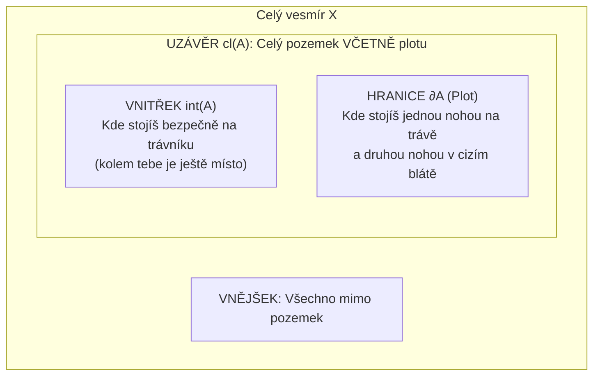

# 🎓 CVIČENÍ 5: TOPOLOGIE A METRICKÉ PROSTORY (TABULE)

> *"Topologie je geometrie na gumovém listu papíru – nezajímá ji přesná vzdálenost na milimetry, ale pouze to, co je 'blízko', co je 'uvnitř', co je 'spojené' a co lze oddělit."*

---

## 📌 ROADMAPA CVIČENÍ & PRŮBĚH TESTOVÁNÍ

| Blok / Příklad | Téma & Klíčové koncepty | Stav | Odkaz na teorii & řešení |
| :---: | :--- | :---: | :---: |
| **Blok 1 (Příklad 1)** | **Eukleidovský prostor na $\mathbb{R}$** • Vnitřek $\operatorname{int}$, uzávěr $\operatorname{cl}$, hranice $\partial$ • Hromadné body $A'$ vs. izolované body $\operatorname{Iso}(A)$ • Spojitý interval $A$ vs. hustá množina zlomků $B = \mathbb{Q} \cap [0, 1]$ | 🔄 *Na řadě k testování* | [Přejít na řešení](#-příklad-1-eukleidovský-prostor-mathbbr-d_2) |
| **Blok 2 (Příklad 2)** | **Konečný topologický prostor $(X, \tau)$** • Hledání uzavřených množin jako doplňků $X \setminus U$ • $\operatorname{int}$, $\operatorname{cl}$, $\partial$ v abstraktní topologii • Minimální báze $\mathcal{B}$ (nerozložitelné otevřené množiny) • Souvislost prostoru (existence netriviálních clopen množin) | ⏳ *Čeká* | [Přejít na řešení](#-příklad-2-konečný-topologický-prostor) |
| **Blok 3 (Příklad 3)** | **Pawlakova topologie & Rough Sets** • Rozklad $U/R$ jako báze topologie $\mathcal{B}_R$ • Dolní aproximace $\underline{R}(A) = \operatorname{int}(A)$ (jistota) • Horní aproximace $\overline{R}(A) = \operatorname{cl}(A)$ (možnost) • Oblast nejistoty $\operatorname{BN}_R(A) = \partial A$ • Proč netriviální Pawlakův prostor není $T_0$ ani metrizovatelný | ⏳ *Čeká* | [Přejít na řešení](#-příklad-3-pawlakova-topologie) |
| **Blok 4 (Příklad 4)** | **Oddělovací axiomy ($T_0, T_1, T_2$) & Metrizovatelnost** • Hierarchie: $T_2 \implies T_1 \implies T_0$ • $T_1 \iff$ jednobodové množiny $\{x\}$ jsou uzavřené • $T_2 \iff$ disjunktní bubliny pro různé body • Test: Indiskrétní, Sierpińského a Kofinitní topologie | ⏳ *Čeká* | [Přejít na řešení](#-příklad-4-oddělovací-axiomy-t_0-t_1-t_2-a-metrizovatelnost) |
| **Blok 5 (Příklad 5)** | **Spojitá zobrazení mezi topologiemi** • Definice: $\forall V \in \tau_Y : f^{-1}(V) \in \tau_X$ • Spojitost z konečného prostoru do konečného • Zobrazení z diskrétního prostoru vs. do diskrétního prostoru | ⏳ *Čeká* | [Přejít na řešení](#-příklad-5-spojité-zobrazení-f--x-tau_x-to-y-tau_y) |

---

## 🟢 KAPITOLA 0: CO TO SAKRA JE TOPOLOGIE? (ZCELA OD NULY)

Pokud ti vzorce připadají jako cizí jazyk, zapomeň na chvíli na řecká písmena a představ si následující 4 obrazy ze života:

### 1. Proč zahazujeme pravítko? (Metafora gumového balónku)
V klasické matematice máme **metriku** $d(x, y)$ – to je **tuhé pravítko**. Říká přesně: bod $A$ je od bodu $B$ vzdálený $3{,}54\text{ cm}$.

Jenže představ si, že nakreslíš obrázek fixou na **nenafouknutý gumový balónek**.
Když balónek nafoukneš a různě ho natahuješ do stran:
- Všechny milimetrové vzdálenosti se úplně změní a zkroutí (pravítko je k ničemu).
- **Ale co se NIKDY nezmění?**
  1. Bod, který byl **uvnitř** nakresleného kruhu, je pořád uvnitř.
  2. Bod, který byl **na okraji (hranici)**, je pořád na okraji.
  3. Skvrna, která byla **v jednom kuse (souvislá)**, se neroztrhla na dva kusy.
  4. Dva oddělené fleky jsou pořád dva oddělené fleky.

👉 **Topologie je matematika, která zkoumá přesně tyto vlastnosti: blízkost, vnitřek, hranici a spojitost bez nutnosti cokoliv měřit na centimetry.**

---

### 2. Jak definovat "blízkost" bez pravítka? BUBLINAMI!
Když nemáme pravítko s centimetry, jak řekneme, že je něco "poblíž"?
Pomocí **otevřených množin** – představ si je jako **mýdlové bubliny**:
- Otevřená množina je zóna bez ostré tvrdé slupky. Kolem každého bodu uvnitř je ještě mikroskopický kousek volného místa.
- **Topologie $\tau$** není nic jiného než **katalog povolených bublin**, na kterých jsme se předem dohodli.

Pravidla pro katalog bublin ($\tau$) jsou jen 3 zdravorozumové zásady:
1. Prázdný prostor $\emptyset$ (žádná bublina) i celý vesmír $X$ (obří bublina) v katalogu musí být.
2. Když sliješ libovolně mnoho bublin dohromady (sjednocení $\bigcup$), vznikne zase platná bublina.
3. Když vezmeš překryv dvou bublin (konečný průnik $\bigcap$), ten překryv je pořád platná menší bublina.

---

### 3. Anatomie množiny: Pozemek, Dům a Plot
Vezměme si libovolnou množinu $A$ (třeba tvůj pozemek):

- **Vnitřek $\operatorname{int}(A)$:** Body bezpečně uvnitř. Můžeš udělat krok v libovolném směru a pořád jsi v $A$.
- **Hranice $\partial A$:** Samotný plot. V každém tvém sebemenším okolí je jak bod z $A$, tak bod mimo $A$.
- **Uzávěr $\operatorname{cl}(A)$:** Celá plocha pozemku včetně plotu: $\operatorname{cl}(A) = \operatorname{int}(A) \cup \partial A$.
- **Hromadný bod $A'$:** Místo velké tlačenice. Kolem tohoto bodu se tísní nekonečně mnoho dalších bodů z $A$ (jako mraveniště).
- **Izolovaný bod $\operatorname{Iso}(A)$:** Osamělý kaktus v poušti. Patří do $A$, ale v jeho těsné blízkosti žádný jiný bod z $A$ není.

> 💡 **Chyták s dveřmi:** V běžném životě jsou dveře buď otevřené, nebo zavřené. V topologii to NEPLATÍ! Množina může být otevřená, uzavřená, **obojí naráz (clopen)**, nebo **ani jedno** (např. interval $(0, 2]$, který má zleva díru a zprava plot).

---

### 4. Oddělovací axiomy ($T_0, T_1, T_2$): Rozlišení monitoru
Máš dva různé body $x \neq y$. Dokáže je tvoje topologie (tvoje bubliny) od sebe rozeznat?

- **Slepý prostor (Indiskrétní):** Nemáš žádné malé bubliny, jen celý vesmír. Body od sebe nerozeznáš. (Nesplňuje ani $T_0$).
- **$T_0$ (Hrubé rozlišení):** Najde se aspoň jedna bublina, která obsahuje bod $x$, ale už neobsahuje $y$.
- **$T_1$ (Ostré body):** Kolem $x$ umíš udělat bublinu bez $y$, a kolem $y$ umíš udělat bublinu bez $x$. To je přesně totéž, jako říct: **každý samostatný bod $\{x\}$ je uzavřený** (je to ostrá tečka, ne rozmazaná šmouha).
- **$T_2$ / Hausdorffův prostor (Perfektní rozlišení):** Bod $x$ zavřeš do jedné bubliny, bod $y$ do druhé, a ty dvě bubliny se **ani nedotknou** ($U \cap V = \emptyset$).

💥 **BOMBA ZKOUŠKOVÉ PRAVIDLO (Věta 5.1):**
Když máš na množině normální pravítko (metriku), vždycky můžeš udělat kolem každého bodu malou kouli o poloměru $r = \frac{1}{2} d(x, y)$ a ty koule se neprotnou!
👉 **Každý prostor s metrikou MUSÍ být $T_2$!**
Pokud prostor selže v $T_2$ (nebo dokonce v $T_0$), **JE NEMOŽNÉ na něm zavést metriku (není metrizovatelný)!**

---

### 5. Pawlakova topologie: Databáze s rozmazaným viděním (Rough Sets)
Představ si databázi pacientů. Kvůli GDPR nemáš jejich jména, znáš jen: `Pohlaví` a `Věkovou skupinu`.
Všichni lidé se stejnými údaji (např. 25letí muži) spadnou do jednoho pytle (třídy ekvivalence): $\{1, 2\}$.

Pro databázi jsou lidé $1$ a $2$ **nerozlišitelní**!
- Když se zeptáš: *"Kdo má chřipku?"* (množina $A$):
  - **Dolní aproximace $\underline{R}(A) = \operatorname{int}(A)$:** Pytle, kde mají chřipku **úplně všichni** (*100% jistota*).
  - **Horní aproximace $\overline{R}(A) = \operatorname{cl}(A)$:** Pytle, kde má chřipku **aspoň jeden člověk** (*možná ano*).
  - **Oblast nejistoty $\operatorname{BN}_R(A) = \partial A$:** $\overline{R}(A) \setminus \underline{R}(A)$ (*tam tápeme, chřipku má jen někdo*).
- **Proč Pawlak není metrizovatelný?** Protože člověka $1$ a $2$ ze stejného pytle nedokážeš žádnou bublinou oddělit – prostor nesplňuje ani $T_0$!

---

### 6. Spojité zobrazení: Netrháme látku
Kdy je funkce $f: X \to Y$ spojitá?
V analýze se říkalo: "kreslíš jedním tahem bez zvednutí tužky".
V topologii je to ještě hezčí:
Vezmi v cíli jakoukoliv pěknou bublinu $V$. Pokud se podíváš, odkud ty body přišly ($f^{-1}(V)$), musí to v původním prostoru být také platná bublina (otevřená množina).
👉 **Vzor otevřené množiny je otevřená množina.**

---

# ✍️ ŘEŠENÍ PŘÍKLADŮ ZE CVIČENÍ 5

---

## 📌 PŘÍKLAD 1: Eukleidovský prostor $(\mathbb{R}, d_2)$

Zadání:
- $A = (0, 2] \cup \{4\}$
- $B = \mathbb{Q} \cap [0, 1]$

### Množina $A = (0, 2] \cup \{4\}$:
1. **Vnitřek $\operatorname{int}(A)$:** Kde máme kolem sebe oboustranný otevřený interval? V $(0, 2)$. Bod $2$ nemá napravo nic z $A$. Bod $4$ nemá kolem sebe vůbec nic z $A$.
   $$\operatorname{int}(A) = (0, 2)$$
2. **Uzávěr $\operatorname{cl}(A)$:** Doplníme krajní body hromadění. K $(0, 2]$ přilepíme $0$. Bod $4$ už v $A$ je.
   $$\operatorname{cl}(A) = [0, 2] \cup \{4\}$$
3. **Hranice $\partial A = \operatorname{cl}(A) \setminus \operatorname{int}(A)$:**
   $$\partial A = ([0, 2] \cup \{4\}) \setminus (0, 2) = \{0, 2, 4\}$$
4. **Hromadné body $A'$:** Které body mají v každém $\varepsilon$-okolí nekonečně mnoho bodů z $A$? Celý interval $[0, 2]$. (Bod $4$ má okolí $(3.9, 4.1)$, kde leží jen on sám $\implies$ není hromadný).
   $$A' = [0, 2]$$
5. **Izolované body $\operatorname{Iso}(A) = A \setminus A'$:**
   $$\operatorname{Iso}(A) = \{4\}$$

---

### Množina $B = \mathbb{Q} \cap [0, 1]$ (racionální čísla v $[0, 1]$):
1. **Vnitřek $\operatorname{int}(B)$:** Existuje nějaký interval $(a, b)$, který by obsahoval *pouze* racionální čísla? **Ne!** Mezi libovolnými dvěma racionálními čísly leží iracionální číslo (např. s $\sqrt{2}$).
   $$\operatorname{int}(B) = \emptyset$$
2. **Uzávěr $\operatorname{cl}(B)$:** K jakým bodům se umíme racionálními čísly libovolně přiblížit? Ke všem reálným číslům v daném intervalu!
   $$\operatorname{cl}(B) = [0, 1]$$
3. **Hranice $\partial B = \operatorname{cl}(B) \setminus \operatorname{int}(B)$:**
   $$\partial B = [0, 1] \setminus \emptyset = [0, 1]$$
4. **Hromadné body $B'$:** V každém okolí libovolného bodu z $[0, 1]$ je nekonečně mnoho zlomků.
   $$B' = [0, 1]$$
5. **Izolované body $\operatorname{Iso}(B) = B \setminus B'$:**
   $$\operatorname{Iso}(B) = \emptyset$$

### 📋 Výsledná tabulka Příklad 1:
| Množina | $\operatorname{int}(\cdot)$ | $\operatorname{cl}(\cdot)$ | $\partial(\cdot)$ | Hromadné body $(\cdot)'$ | Izolované body $\operatorname{Iso}(\cdot)$ |
| :--- | :--- | :--- | :--- | :--- | :--- |
| $A = (0, 2] \cup \{4\}$ | $(0, 2)$ | $[0, 2] \cup \{4\}$ | $\{0, 2, 4\}$ | $[0, 2]$ | $\{4\}$ |
| $B = \mathbb{Q} \cap [0, 1]$ | $\emptyset$ | $[0, 1]$ | $[0, 1]$ | $[0, 1]$ | $\emptyset$ |

---

## 📌 PŘÍKLAD 2: Konečný topologický prostor

Množina $X = \{a, b, c, d\}$.
- $\tau_1 = \{\emptyset, \{a\}, \{c\}, \{a, c\}, \{a, b, c\}, X\}$
- $\tau_2 = \{\emptyset, \{a\}, \{b, c, d\}, X\}$
Podmnožiny: $M = \{b, c\}$, $N = \{a, b, c\}$.

### a) Uzavřené množiny (doplňky otevřených $X \setminus U$):
- **V $(X, \tau_1)$:**
  - $X \setminus \emptyset = X$
  - $X \setminus \{a\} = \{b, c, d\}$
  - $X \setminus \{c\} = \{a, b, d\}$
  - $X \setminus \{a, c\} = \{b, d\}$
  - $X \setminus \{a, b, c\} = \{d\}$
  - $X \setminus X = \emptyset$
  $$\mathcal{F}_1 = \{\emptyset, \{d\}, \{b, d\}, \{a, b, d\}, \{b, c, d\}, X\}$$

- **V $(X, \tau_2)$:**
  - $X \setminus \emptyset = X$
  - $X \setminus \{a\} = \{b, c, d\}$
  - $X \setminus \{b, c, d\} = \{a\}$
  - $X \setminus X = \emptyset$
  $$\mathcal{F}_2 = \{\emptyset, \{a\}, \{b, c, d\}, X\}$$
  *(Všimni si: v $\tau_2$ jsou všechny množiny otevřené i uzavřené zároveň!)*

---

### b) Určení $\operatorname{int}$, $\operatorname{cl}$, $\partial$:

#### V prostoru $(X, \tau_1)$:
- **Pro $M = \{b, c\}$:**
  - $\operatorname{int}(M)$: největší otevřená uvnitř $\{b, c\}$ $\to$ z otevřených množin $\emptyset, \{a\}, \{c\}, \{a, c\}, \{a, b, c\}, X$ se do $M$ vejde jen $\{c\}$ a $\emptyset$. Největší je $\{c\}$.
    $$\operatorname{int}(M) = \{c\}$$
  - $\operatorname{cl}(M)$: nejmenší uzavřená obalující $\{b, c\}$ $\to$ z uzavřených $\mathcal{F}_1$ obsahují $\{b, c\}$ množiny $\{b, c, d\}$ a $X$. Nejmenší je $\{b, c, d\}$.
    $$\operatorname{cl}(M) = \{b, c, d\}$$
  - $\partial M = \operatorname{cl}(M) \setminus \operatorname{int}(M) = \{b, c, d\} \setminus \{c\} = \{b, d\}$.

- **Pro $N = \{a, b, c\}$:**
  - $\operatorname{int}(N)$: $\{a, b, c\}$ je přímo v $\tau_1$ (je otevřená!), takže největší otevřená uvnitř je ona sama:
    $$\operatorname{int}(N) = \{a, b, c\} = N$$
  - $\operatorname{cl}(N)$: uzavřená nadmnožina z $\mathcal{F}_1$ obsahující $\{a, b, c\}$ je pouze celá $X$.
    $$\operatorname{cl}(N) = X = \{a, b, c, d\}$$
  - $\partial N = X \setminus \{a, b, c\} = \{d\}$.

#### V prostoru $(X, \tau_2)$:
- **Pro $M = \{b, c\}$:**
  - $\operatorname{int}(M)$: otevřené jsou $\emptyset, \{a\}, \{b, c, d\}, X$. Žádná neprázdná se do $\{b, c\}$ nevejde.
    $$\operatorname{int}(M) = \emptyset$$
  - $\operatorname{cl}(M)$: uzavřené obsahující $\{b, c\}$ jsou $\{b, c, d\}$ a $X$. Nejmenší je $\{b, c, d\}$.
    $$\operatorname{cl}(M) = \{b, c, d\}$$
  - $\partial M = \{b, c, d\} \setminus \emptyset = \{b, c, d\}$.

- **Pro $N = \{a, b, c\}$:**
  - $\operatorname{int}(N)$: z otevřených se dovnitř vejde $\{a\}$ a $\emptyset$. Největší je $\{a\}$.
    $$\operatorname{int}(N) = \{a\}$$
  - $\operatorname{cl}(N)$: z uzavřených $\emptyset, \{a\}, \{b, c, d\}, X$ obsahuje $N$ pouze $X$.
    $$\operatorname{cl}(N) = X$$
  - $\partial N = X \setminus \{a\} = \{b, c, d\}$.

### 📋 Výsledná tabulka Příklad 2 (b):
| Prostor a množina | $\operatorname{int}(\cdot)$ | $\operatorname{cl}(\cdot)$ | $\partial(\cdot)$ |
| :--- | :--- | :--- | :--- |
| $\tau_1 : M$ | $\{c\}$ | $\{b, c, d\}$ | $\{b, d\}$ |
| $\tau_1 : N$ | $\{a, b, c\}$ | $X$ | $\{d\}$ |
| $\tau_2 : M$ | $\emptyset$ | $\{b, c, d\}$ | $\{b, c, d\}$ |
| $\tau_2 : N$ | $\{a\}$ | $X$ | $\{b, c, d\}$ |

---

### c) Minimální báze:
Báze $\mathcal{B}$ je kolekce otevřených množin, ze kterých sjednocením poskládáme celou topologii. Hledáme "nerozložitelné cihly" (množiny, které nevzniknou sjednocením jiných otevřených).

- **Pro $\tau_1$:**
  - $\{a, c\} = \{a\} \cup \{c\}$ $\implies$ $\{a, c\}$ nepotřebujeme.
  - $\{a, b, c\}$ nelze složit ze žádných menších otevřených (žádná neobsahuje $b$). Musí v bázi být!
  - $X$ nelze složit ze žádných menších otevřených (žádná neobsahuje $d$). Musí v bázi být!
  - $\{a\}$ a $\{c\}$ jsou jednoprvkové nerozložitelné.
  $$\mathcal{B}_1 = \{\{a\}, \{c\}, \{a, b, c\}, X\}$$

- **Pro $\tau_2$:**
  - Množina $X = \{a\} \cup \{b, c, d\}$. Tedy $X$ vznikne sjednocením a v bázi být nemusí!
  $$\mathcal{B}_2 = \{\{a\}, \{b, c, d\}\}$$

---

### d) Souvislost prostorů:
- **$(X, \tau_1)$:** Lze $X$ rozložit na dvě neprázdné disjunktní otevřené množiny? 
  Ne, jediné otevřené jsou $\emptyset, \{a\}, \{c\}, \{a, c\}, \{a, b, c\}, X$. Žádné dvě nemají sjednocení $X$ s prázdným průnikem. Jediné clopen množiny jsou $\emptyset$ a $X$.
  $$\implies (X, \tau_1) \text{ je SOUVISLÝ}$$
- **$(X, \tau_2)$:** Máme otevřené množiny $\{a\}$ a $\{b, c, d\}$. Jsou neprázdné, disjunktní a $\{a\} \cup \{b, c, d\} = X$.
  $$\implies (X, \tau_2) \text{ je NESOUVISLÝ}$$

---

## 📌 PŘÍKLAD 3: Pawlakova topologie

$U = \{1, 2, 3, 4, 5, 6\}$, rozklad $U/R = \{\{1, 2\}, \{3, 4, 5\}, \{6\}\}$.

### a) Báze a topologie:
- **Báze $\mathcal{B}_R$:** Přímo třídy rozkladu:
  $$\mathcal{B}_R = \{\{1, 2\}, \{3, 4, 5\}, \{6\}\}$$
- **Topologie $\tau_R$:** Všechna sjednocení bázových prvků ($2^3 = 8$ množin):
  $$\tau_R = \{\emptyset, \{1, 2\}, \{3, 4, 5\}, \{6\}, \{1, 2, 3, 4, 5\}, \{1, 2, 6\}, \{3, 4, 5, 6\}, U\}$$

---

### b) Dolní, horní aproximace a hranice:
Pravidlo je jednoduché:
- **Dolní aproximace $\underline{R}(Y) = \operatorname{int}(Y)$:** Které třídy jsou **celé uvnitř** $Y$?
- **Horní aproximace $\overline{R}(Y) = \operatorname{cl}(Y)$:** Které třídy mají s $Y$ **aspoň 1 prvek společný**?
- **Hranice $\operatorname{BN}_R(Y) = \partial Y = \overline{R}(Y) \setminus \underline{R}(Y)$**.

#### Pro $A = \{2, 3, 4\}$:
- Třída $\{1, 2\}$: uvnitř je jen $2 \implies$ není celá v $A$.
- Třída $\{3, 4, 5\}$: uvnitř jsou $3, 4$, ale chybí $5 \implies$ není celá v $A$.
- Třída $\{6\}$: nemá s $A$ nic společného.
- **$\operatorname{int}(A) = \underline{R}(A) = \emptyset$**
- Které se dotýkají? $\{1, 2\}$ a $\{3, 4, 5\}$.
- **$\operatorname{cl}(A) = \overline{R}(A) = \{1, 2\} \cup \{3, 4, 5\} = \{1, 2, 3, 4, 5\}$**
- **$\partial A = \operatorname{BN}_R(A) = \{1, 2, 3, 4, 5\} \setminus \emptyset = \{1, 2, 3, 4, 5\}$**

#### Pro $B = \{1, 2, 3, 4\}$:
- Třída $\{1, 2\}$: celá leží v $B$! $\implies \{1, 2\}$
- Třída $\{3, 4, 5\}$: chybí $5 \implies$ není celá v $B$.
- **$\operatorname{int}(B) = \underline{R}(B) = \{1, 2\}$**
- Které se dotýkají? $\{1, 2\}$ a $\{3, 4, 5\}$.
- **$\operatorname{cl}(B) = \overline{R}(B) = \{1, 2, 3, 4, 5\}$**
- **$\partial B = \operatorname{BN}_R(B) = \{1, 2, 3, 4, 5\} \setminus \{1, 2\} = \{3, 4, 5\}$**

### 📋 Výsledná tabulka Příklad 3:
| Množina | $\operatorname{int}(\cdot) = \underline{R}(\cdot)$ | $\operatorname{cl}(\cdot) = \overline{R}(\cdot)$ | $\partial(\cdot) = \operatorname{BN}_R(\cdot)$ |
| :--- | :--- | :--- | :--- |
| $A = \{2, 3, 4\}$ | $\emptyset$ | $\{1, 2, 3, 4, 5\}$ | $\{1, 2, 3, 4, 5\}$ |
| $B = \{1, 2, 3, 4\}$ | $\{1, 2\}$ | $\{1, 2, 3, 4, 5\}$ | $\{3, 4, 5\}$ |

---

### c) Vlastnosti prostoru $(U, \tau_R)$:
1. **Souvislost:** Třídy rozkladu $\{1, 2\}$ a $\{3, 4, 5, 6\}$ jsou obě otevřené, disjunktní a dávají $U$. $\implies$ **NESOUVISLÝ**.
2. **Oddělovací axiomy ($T_0, T_1, T_2$):**
   - Vezměme body $1$ a $2$. Leží v téže třídě $\{1, 2\}$.
   - Jakákoliv otevřená množina obsahující $1$ musí obsahovat i celou bázovou třídu $\{1, 2\}$, a tedy obsahuje i $2$!
   - Neexistuje otevřená množina obsahující $1$ bez $2$, ani $2$ bez $1$.
   - $\implies$ **NESPLŇUJE $T_0$**! (A tedy nesplňuje ani $T_1$, ani $T_2$).
3. **Metrizovatelnost:** Každý metrizovatelný prostor musí splňovat $T_2$. Jelikož nesplňuje ani $T_0$, **NENÍ metrizovatelný**.

---

## 📌 PŘÍKLAD 4: Oddělovací axiomy $T_0, T_1, T_2$ a metrizovatelnost

### a) Indiskrétní prostor na $X = \{1, 2\}$ s $\tau = \{\emptyset, X\}$:
- Otevřené množiny jsou jen $\emptyset$ a $\{1, 2\}$.
- Body $1$ a $2$ nelze oddělit žádnou otevřenou množinou.
- **$T_0$: NE**, **$T_1$: NE**, **$T_2$: NE**.
- **Metrizovatelnost: NE** (metrický prostor se dvěma body by měl $d(1, 2) > 0$ a koule $B(1, d/2)$ by obsahovala pouze $1$, což zde nelze).

### b) Sierpińského prostor na $X = \{0, 1\}$ s $\tau = \{\emptyset, \{1\}, \{0, 1\}\}$:
- **$T_0$:** Dvojice bodů $\{0, 1\}$. Existuje otevřená množina obsahující jeden a ne druhý? Ano, $\{1\}$ obsahuje $1$ a neobsahuje $0$. $\implies$ **$T_0$: ANO**.
- **$T_1$:** Existuje otevřená množina obsahující $0$ a neobsahující $1$? Jediné otevřené jsou $\emptyset, \{1\}, \{0, 1\}$. Žádná taková neexistuje! (Nebo: jednoprvková množina $\{1\}$ není uzavřená, protože $X \setminus \{1\} = \{0\} \notin \tau$). $\implies$ **$T_1$: NE** (a tím automaticky i **$T_2$: NE**).
- **Metrizovatelnost: NE** (protože není $T_2$).

### c) Kofinitní topologie na $X = \mathbb{R}$ (otevřené = $\emptyset$ a ty s konečným doplňkem):
- **$T_1$:** Pro každý bod $x \in \mathbb{R}$ je jednoprvková množina $\{x\}$ konečná. Tedy její doplněk $\mathbb{R} \setminus \{x\}$ má konečný doplněk $\implies$ je otevřený $\implies$ jednoprvková množina $\{x\}$ je **uzavřená**! Všude, kde jsou jednoprvkové množiny uzavřené, platí $T_1$. $\implies$ **$T_1$: ANO** (a tedy i **$T_0$: ANO**).
- **$T_2$:** Mohou mít dva body $x \neq y$ disjunktní otevřená okolí $U \cap V = \emptyset$?
  - Kdyby $U \cap V = \emptyset$, pak po přechodu k doplňkům:
    $$\mathbb{R} = \mathbb{R} \setminus \emptyset = \mathbb{R} \setminus (U \cap V) = (\mathbb{R} \setminus U) \cup (\mathbb{R} \setminus V)$$
  - Jenže $\mathbb{R} \setminus U$ i $\mathbb{R} \setminus V$ jsou konečné množiny! Sjednocení dvou konečných množin je konečná množina, což nemůže být celé $\mathbb{R}$!
  - Tedy každé dvě neprázdné otevřené množiny se **MUSÍ protínat**! Žádná dvě disjunktní okolí neexistují.
  - $\implies$ **$T_2$: NE**.
- **Metrizovatelnost: NE** (protože není $T_2$).

---

## 📌 PŘÍKLAD 5: Spojité zobrazení $f : (X, \tau_X) \to (Y, \tau_Y)$

Kritérium: $f$ je spojité $\iff \forall V \in \tau_Y : f^{-1}(V) \in \tau_X$.

### a) $X = \{1, 2, 3\}$, $\tau_X = \{\emptyset, \{1\}, \{1, 2\}, X\}$ a $Y = \{a, b\}$, $\tau_Y = \{\emptyset, \{a\}, Y\}$:
Předpis: $f(1) = a, f(2) = a, f(3) = b$.
Prověříme vzory všech otevřených množin z $\tau_Y$:
- $f^{-1}(\emptyset) = \emptyset \in \tau_X$ ✅
- $f^{-1}(Y) = X \in \tau_X$ ✅
- $f^{-1}(\{a\}) = \{x : f(x) = a\} = \{1, 2\}$. Patří $\{1, 2\}$ do $\tau_X$? **Ano!** ✅
Všechny vzory jsou otevřené v $X$ $\implies$ **$f$ JE SPOJITÉ**.

### b) Identita $\operatorname{id} : (\mathbb{R}, \tau_{\text{diskr}}) \to (\mathbb{R}, \tau_{\text{std}})$:
- V diskrétní topologii je **každá podmnožina otevřená** ($\tau_{\text{diskr}} = \mathcal{P}(\mathbb{R})$).
- Pro jakoukoliv otevřenou $V \in \tau_{\text{std}}$ je vzor $\operatorname{id}^{-1}(V) = V$.
- Protože $V \subseteq \mathbb{R}$, je v $\tau_{\text{diskr}}$ automaticky otevřená.
- $\implies$ **$\operatorname{id}$ JE SPOJITÉ**.
*(Obecná věta: Zobrazení z diskrétního prostoru kamkoliv je vždy spojité!)*

### c) Identita $\operatorname{id} : (\mathbb{R}, \tau_{\text{std}}) \to (\mathbb{R}, \tau_{\text{diskr}})$:
- V cílovém prostoru s diskrétní topologií je otevřená např. množina $\{0\}$.
- Její vzor je $\operatorname{id}^{-1}(\{0\}) = \{0\}$.
- Je jednoprvková množina $\{0\}$ otevřená v eukleidovské topologii $(\mathbb{R}, \tau_{\text{std}})$? **Není!** (Neobsahuje žádný otevřený interval $(-\varepsilon, \varepsilon)$).
- Vzor otevřené množiny není otevřený $\implies$ **$\operatorname{id}$ NENÍ SPOJITÉ**.
