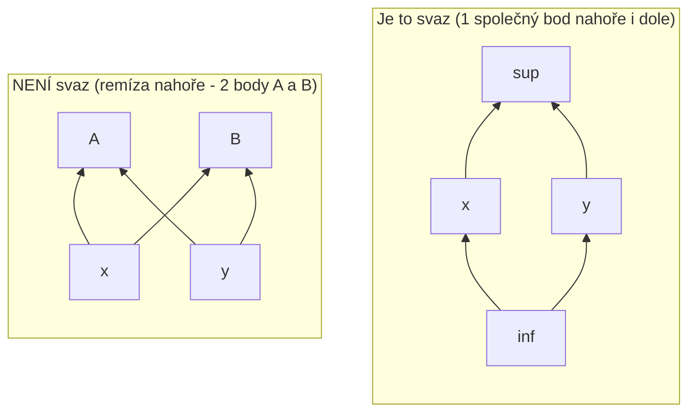
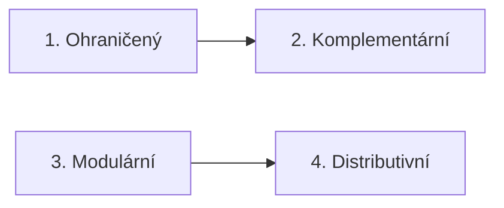
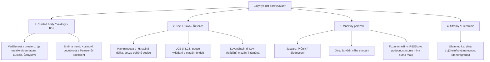

# 🧠 Kompletní tahák teorie & vzorců (MPI – Cvičení 1 až 4)
> **Kompletní a praktický přehled pro rychlé zopakování.** Žádná zbytečná omáčka – čisté definice, lidská vysvětlení, vizuální grafy, přesné vzorce a triky k testu.

---

## 📑 Rychlý rozcestník
### Cvičení 1:
1. [Posety, diagramy a extrémy](#1-posety-hasseovy-diagramy-a-extrémy)
2. [Svazy, podsvazy a jejich vlastnosti](#2-svazy-lattices-a-jejich-vlastnosti)
3. [Binární operace, řády prvků a žebříček grup](#3-binární-operace-a-algebraické-struktury)
4. [Dvě operace: Okruh, dělitelé nuly vs. Těleso](#4-dvě-operace-okruh-vs-těleso)
5. [Cayleyho tabulky & Izomorfismus](#5-cayleyho-tabulky-modulo-a-izomorfismus)
6. [Galoisovo těleso GF(2) a Vektorové prostory](#6-galoisovo-těleso-gf2-a-vektorové-prostory)

### Cvičení 2 (FCA & Uzávěry):
7. [Uzávěrové systémy a operátor cl](#7-uzávěrové-systémy-a-operátor-cl)
8. [Formální kontext a derivační operátory (Šipky)](#8-formální-kontext-a-derivační-operátory-šipky)
9. [Formální koncepty a konceptuální svaz (Algoritmus průniků)](#9-formální-koncepty-a-konceptuální-svaz)
10. [Asociační pravidla (supp, conf, lift)](#10-asociační-pravidla-supp-conf-lift)
11. [Algoritmus Apriori & Rymon tree](#11-algoritmus-apriori--rymon-tree)

### Cvičení 3 (Fuzzy logika & Rough Sets):
12. [Fuzzy množiny a operace (Zadeh, Součin, Łukasiewicz)](#12-fuzzy-množiny-a-fuzzy-operace)
13. [Princip extenze a spojitý lichoběžník](#13-princip-extenze-a-spojitý-lichoběžník)
14. [Hrubé množiny (Rough Sets) a aproximace](#14-hrubé-množiny-rough-sets-a-aproximace)
15. [Rozhodovací systémy, redukty a QuickReduct](#15-rozhodovací-systémy-redukty-a-quickreduct)

### Cvičení 4 (Metriky, vzdálenosti a podobnosti):
16. [Metriky, Míry podobnosti a Vzdálenosti](#16-metriky-míry-podobnosti-a-vzdálenosti-cvičení-4)
    - [Axiomy metriky, pseudometrika a ultrametrika](#-1-axiomy-metriky-a-ultrametriky)
    - [Vektorové Lp metriky](#-2-metriky-lp-na-vektorech-mathbfrn-minkowského-vzdálenosti)
    - [Kosinus vs. Pearson](#-3-směrové-a-trendové-míry-kosinus-vs-pearson)
    - [Vzdálenosti slov (Hamming, LCS, Levenshtein)](#-4-vzdálenosti-mezi-slovy--řetězci)
    - [Podobnosti množin (Jaccard, Dice, Růžička)](#-5-množinové-a-fuzzy-podobnosti-jaccard-dice-růžička)
    - [Převodníky mezi vzdáleností a podobností](#-6-převodníky-mezi-podobností-a-vzdáleností)

---

# 1. Posety, Hasseovy diagramy a extrémy

### 🔹 Co je to Poset (Částečně uspořádaná množina)?
Množina s relací $\le$ (často dělitelnost $\mid$), která splňuje:
1. **Reflexivita:** $a \le a$ (každý je v relaci sám se sebou)
2. **Antisymetrie:** Pokud $a \le b$ a $b \le a$, pak $a = b$ (neexistují obousměrné cykly)
3. **Tranzitivita:** Pokud $a \le b$ a $b \le c$, pak $a \le c$ (lze jít po schodech)

---

### 🔹 Extrémy vs. Závory (Kde lidé nejvíc chybují!)

```
  EXTRÉMY (min, max, nejmenší, největší)    ZÁVORY (dolní, horní, inf, sup)
  👉 Hledají se POUZE UVNITŘ podmnožiny!     👉 Hledají se V CELÉM POSETU (zvenku i zevnitř)!
```

| Pojem | Definice lidsky | Kolik jich může být? |
| :--- | :--- | :--- |
| **Minimální prvek** | V podmnožině pod ním **už nic neleží** (nemá v podmnožině předchůdce). | Může jich být **více**! |
| **Maximální prvek** | V podmnožině nad ním **už nic neleží** (nemá v podmnožině následovníka). | Může jich být **více**! |
| **Nejmenší prvek** | Leží **pod ÚPLNĚ VŠEMI** ostatními prvky podmnožiny. | Maximálně **jeden** (nebo žádný). |
| **Největší prvek** | Leží **nad ÚPLNĚ VŠEMI** ostatními prvky podmnožiny. | Maximálně **jeden** (nebo žádný). |
| **Dolní závory** | Všechny prvky z posetu, které jsou menší/rovny všem prvkům podmnožiny. | Celá množina čísel. |
| **Horní závory** | Všechny prvky z posetu, které jsou větší/rovny všem prvkům podmnožiny. | Celá množina čísel. |
| **Infimum ($\inf$)** | **Největší dolní závora** (strop podlahy, nejblíže zespodu). | Max. jeden (u dělitelnosti $\gcd$). |
| **Supremum ($\sup$)** | **Nejmenší horní závora** (podlaha stropu, nejblíže shora). | Max. jeden (u dělitelnosti $\operatorname{lcm}$). |

> 💡 **Zlaté pravidlo:** Pokud má podmnožina *nejmenší prvek*, je to automaticky její *infimum*! Pokud má *největší prvek*, je to rovnou její *supremum*!

---

# 2. Svazy (Lattices) a jejich vlastnosti

### 🔹 Co je to Svaz?
Poset je svaz, pokud pro **každou dvojici prvků** existuje $\inf$ i $\sup$.
- **Lidsky:** Kdykoliv ukážeš na 2 prvky, směrem nahoru se potkají v **jediném nejbližším bodě** a směrem dolů také v **jediném nejbližším bodě**.



> 📌 **Textová verze grafu (kdyby se Mermaid v editoru nenačetl):**
> ```text
>     SVAZ:                     NENÍ SVAZ:
>     [ sup ]                   [ A ]   [ B ]  <-- 2 rovnocenné body nahoře
>     /     \                   /   \   /   \
>   [x]     [y]               [x]     X     [y]
>     \     /                   \   /   \   /
>     [ inf ]                  (chybí jediný vítěz)
> ```

---

### 🔹 4 Vlastnosti svazů (Rychlý tahák)



1. **Ohraničenost:**
   - Má společné úplné dno ($0$) i úplný strop ($1$).
   - Všechny konečné svazy dělitelů $D_n$ jsou ohraničené ($0 = 1$, $1 = n$).
2. **Komplementarita (Puzzle):**
   - Ke každému prvku $x$ existuje doplněk $y$ tak, že:
     $$x \wedge y = 0 \quad (\inf \text{ je dno}) \qquad \text{a} \qquad x \vee y = 1 \quad (\sup \text{ je strop})$$
   - *Pravidlo:* $D_n$ je komplementární jen tehdy, když $n$ **neobsahuje žádné mocniny** prvočísel ($D_{30} = 2 \cdot 3 \cdot 5$ ano, ale $D_{12} = 2^2 \cdot 3$ ne!).
3. **Modularita:**
   - Neobsahuje zakázaný pětiúhelník $N_5$ jako podsvaz.
4. **Distributivita:**
   - Neobsahuje pětiúhelník $N_5$ ani diamant se 3 větvemi $M_3$ (v některých testech značený jako $M_5$).
   - 🎯 **Tahák:** **Každý svaz dělitelů $D_n$ s $\gcd$ a $\operatorname{lcm}$ je VŽDY distributivní i modulární!**
5. **Booleovský svaz (Booleova algebra):**
   - Svaz, který je **distributivní a komplementární zároveň** (např. systém všech podmnožin $(\mathcal{P}(X), \subseteq)$, nebo dělitelé bezčtvercového čísla $D_{30}$).

---

### 🔹 Kdy je podmnožina PODSVAZEM? (Zkouškový chyták!)
Mějme svaz $(L, \le)$ a podmnožinu $S \subseteq L$:
* Podmnožina $S$ je **podsvazem** svazu $L$ právě tehdy, když je **uzavřená na původní operace průseku a spojení**:
  $$\forall a, b \in S: \quad a \wedge_L b \in S \quad \text{a zároveň} \quad a \vee_L b \in S$$
* ⚠️ **Chyták:** Množina může být *svazem sama o sobě*, ale *NENÍ podsvazem*, pokud její spojení vyletí ven!
  - *Příklad:* $S = \{1, 2, 3, 36\} \subset D_{36}$. Pro prvky $2, 3 \in S$ je v původním svazu $2 \vee_{D_{36}} 3 = \operatorname{lcm}(2, 3) = \mathbf{6 \notin S}$. Tedy $S$ není podsvazem $D_{36}$!

---

# 3. Binární operace a algebraické struktury

Máme množinu $M$ a operaci $*$ (např. $a * b = a + b - 3$).

### 🔹 6 Vlastností k ověření:
1. **Uzavřenost:** Výsledek operace musí zůstat v množině $M$ ($\forall a, b \in M: a * b \in M$).
2. **Komutativita:** $a * b = b * a$ (nezáleží na pořadí).
3. **Asociativita:** $(a * b) * c = a * (b * c)$ (nezáleží na závorkách).
   - *Postup:* Znormalizuj levou stranu, znormalizuj pravou stranu, porovnej výrazy!
4. **Neutrální prvek ($e$):**
   $$a * e = e * a = a$$
   *(Sestav rovnici a vyjádři neznámou $e$. U běžného sčítání $e=0$, u násobení $e=1$).*
5. **Inverzní prvek ($a^{-1}$):**
   $$a * a^{-1} = a^{-1} * a = e$$
   *(Dosaď už známé číslo $e$ a z rovnice vyjádři vzorec pro $a^{-1}$. Musí existovat pro VŠECHNY prvky množiny!).*
6. **Nulový (agresivní) prvek ($z$):**
   $$a * z = z * a = z$$
   *(Prvek, který vše pohltí – např. $0$ při běžném násobení čísel: $x \cdot 0 = 0$).*

---

### 🔹 Řád prvku v grupě $\operatorname{ord}(a)$ (Ciferník):
Řád prvku $a$ je **nejmenší kladné celé číslo $k \ge 1$**, kolikrát musíme prvek zoperovat, abychom dostali **neutrální prvek $e$**:
* Při násobení: $a^k = e$ (hledáme nejmenší $k \ge 1$, aby $a^k = 1$).
* Při sčítání: $k \cdot a = e$ (hledáme nejmenší $k \ge 1$, aby $k \cdot a = 0$).
* **Zlatá pravidla k řádu:**
  - Neutrální prvek má **VŽDY řád 1** (a je jediný!).
  - V konečné grupě řád prvku vždy dělí velikost celé grupy: $\operatorname{ord}(a) \mid |G|$ (Lagrangeova věta).
  - Pokud se na neutrální prvek nelze dostat (např. v $(\mathbb{Z}, +)$ pro číslo 2: $2, 4, 6, 8 \dots$), prvek má **nekonečný řád $\infty$**.

---

### 🔹 Schody ke slávě (Hierarchie struktur)

```
  [ Grupoid ]            --> Uzavřená operace
      ⬇ + asociativita
  [ Pologrupa ]          --> Můžeš libovolně závorkovat
      ⬇ + neutrální prvek (e)
  [ Monoid ]             --> Má "neviditelný" prvek e
      ⬇ + inverzní prvky ke všemu (a⁻¹)
  [ GRUPA ]              --> Každý prvek lze vynulovat inverzí
      ⬇ + komutativita
  [ Abelovská grupa ]    --> Můžeš navíc prohazovat pořadí!
```

---

# 4. Dvě operace: Okruh, dělitelé nuly vs. Těleso

Zkoumáme struktury se sčítáním i násobením: $(M, +, \cdot)$.

```
                     OKRUH (Ring)                     TĚLESO (Field)
-----------------------------------------------------------------------------
Sčítání (+)         Abelovská grupa                  Abelovská grupa
Násobení (·)        Asociativní pologrupa            Abelovská grupa (bez nuly!)
Roznásobování       Funguje distributivita           Funguje distributivita
Dělení / Inverze    ❌ NELZE obecně dělit!           ✅ LZE dělit vším kromě 0!
Příklad ze života   Celá čísla Z (5/2 není v Z)       Racionální čísla Q, R, C
```

### 🔹 Dělitelé nuly (Zero Divisors):
Dva nenulové prvky $a \neq 0$ a $b \neq 0$, jejichž součin dá nulu:
$$a \cdot b = 0$$
* **Příklad v $\mathbb{Z}_4$:** $2 \neq 0$, ale $2 \cdot 2 = 4 \equiv 0 \pmod 4 \implies 2$ je dělitel nuly!
* **Příklad v maticích $M_{2\times 2}(\mathbb{R})$:**
  $$\begin{pmatrix} 0 & 1 \\ 0 & 0 \end{pmatrix} \cdot \begin{pmatrix} 1 & 0 \\ 0 & 0 \end{pmatrix} = \begin{pmatrix} 0 & 0 \\ 0 & 0 \end{pmatrix}$$
* **Obor integrity:** Komutativní okruh s jednotkou, který **nemá žádné dělitele nuly** (např. $\mathbb{Z}$).

### 🎯 Trik pro Modulo $\mathbb{Z}_n$:
* Pokud je $n$ **PRVOČÍSLO** ($\mathbb{Z}_2, \mathbb{Z}_3, \mathbb{Z}_5, \mathbb{Z}_7 \dots$) $\implies$ **TĚLESO $\mathbb{F}_p$** (nemá dělitele nuly, každý nenulový prvek má inverzi).
* Pokud je $n$ **SLOŽENÉ ČÍSLO** ($\mathbb{Z}_4, \mathbb{Z}_6, \mathbb{Z}_8 \dots$) $\implies$ **JEN OKRUH** (existují dělitelé nuly, takže těleso to nikdy být nemůže!).

---

### 🔹 Kongruence a faktorová množina:
* Ekvivalence $\sim$ na algebře se nazývá **kongruence**, pokud zachovává všechny její operace:
  $$a_1 \sim a_2 \quad \text{a zároveň} \quad b_1 \sim b_2 \implies (a_1 \circ b_1) \sim (a_2 \circ b_2)$$
* Dělí množinu na třídy $[a]$, které tvoří faktorovou algebru $A / \sim$ (např. $\mathbb{Z} / \equiv_n = \mathbb{Z}_n$).

---

# 5. Cayleyho tabulky, Modulo a Izomorfismus

### 🔹 Jak číst Cayleyho tabulku:
*   **Komutativita:** Tabulka je zrcadlově souměrná podle hlavní diagonály (shora zleva dolů doprava).
*   **Jednotkový prvek ($e$ nebo $1$):** Řádek a sloupec vypadají přesně jako záhlaví tabulky.
*   **Nulový prvek ($0$):** Celý řádek a sloupec jsou plné samých nul.
*   **Inverze k $a$:** V řádku $a$ najdi jedničku ($e$) a podívej se na název sloupce.

---

### 🔹 Co je to Izomorfismus $\cong$?
Dvě struktury jsou **izomorfní**, pokud fungují naprosto stejně, jen mají prvky jinak pojmenované.
*   **Jak rychle poznat, že NEJSOU izomorfní:**
    Najdi vlastnost, kterou jedna má a druhá ne!
    - Např. v $(\mathbb{Z}_8^*, \cdot)$ platí pro každý prvek $x \cdot x = 1$ (každý složený sám se sebou dá hned jednotku).
    - Ale v $(\mathbb{Z}_4, +)$ platí $1 + 1 = 2 \neq 0$ (musíš jedničku sečíst až 4×, abys dostal nulu).
    - $\implies$ **Nejsou izomorfní!**

---

# 6. Galoisovo těleso $GF(2)$ a Vektorové prostory

### 🔹 Co je $GF(2)$?
Aritmetika modulo 2 nad bity $\{0, 1\}$:
* **Sčítání $\oplus$:** Funguje jako **XOR** ($0\oplus 0 = 0, \ 0\oplus 1 = 1, \ 1\oplus 1 = \mathbf{0}$).
* **Násobení $\otimes$:** Funguje jako **AND** ($1\otimes 1 = 1$, jinak samé $0$).

---

### 🔹 Vektorový prostor $GF(2)^n$
Prostor $n$-tic nul a jedniček (např. $GF(2)^3$ jsou 3-bitové vektory):

| Vlastnost | Výpočet pro $GF(2)^3$ | Význam |
| :--- | :--- | :--- |
| **Počet všech vektorů** | $2^n = 2^3 = \mathbf{8}$ | Všechny binární kombinace od `(0,0,0)` po `(1,1,1)`. |
| **Standardní báze $\mathcal{E}$** | $\{(1,0,0), (0,1,0), (0,0,1)\}$ | Minimální sada vektorů, která vygeneruje celý prostor. |
| **Dimenze prostoru** | $\dim(V) = n = \mathbf{3}$ | Počet vektorů v bázi (odpovídá délce vektoru). |
| **Sčítání vektorů** | Po složkách přes XOR | $(1, 0, 1) \oplus (1, 1, 0) = (0, 1, 1)$. |
| **Skalární násobek** | $1 \otimes u = u$, \ $0 \otimes u = \vec{0}$ | Vynásobení číslem z tělesa. |

---

# 7. Uzávěrové systémy a operátor cl

### 🔹 Co je to Uzávěrový systém $\mathcal{C}$ na množině $X$?
Systém vybraných podmnožin $\mathcal{C} \subseteq \mathcal{P}(X)$, který splňuje **2 podmínky**:
1. **Obsahuje celé $X$:** $X \in \mathcal{C}$
2. **Je uzavřený na průniky ($\cap$):** Pro libovolné dvě množiny z klubu platí $A \cap B \in \mathcal{C}$ (obecně pro libovolný podsystém $\bigcap \mathcal{S} \in \mathcal{C}$).

> 💡 **Metafora VIP Klubu:**
> Množiny v $\mathcal{C}$ jsou „VIP členové“. Pokud vezmeš jakékoliv dva členy a podíváš se, co mají společného (jejich průnik), výsledek musí být **také v klubu**. Pokud průnik vypadne ven, systém není uzávěrový!
> - *Příklad chytáku:* $X = \{1, 2, 3, 4\}$, $\mathcal{C}_1 = \{\{1, 2\}, \{1, 3\}, \{1, 2, 3\}, X\}$.
>   Uděláme průnik $\{1, 2\} \cap \{1, 3\} = \{1\}$. Protože $\{1\} \notin \mathcal{C}_1 \implies \mathcal{C}_1$ **NENÍ** uzávěrový systém!
>   Když přidáme $\{1\}$, systém $\mathcal{C}_2 = \mathcal{C}_1 \cup \{\{1\}\}$ už uzávěrový **JE**.

---

### 🔹 Uzávěrový operátor $\operatorname{cl}(Y)$
Hledáme uzávěr pro libovolnou množinu $Y \subseteq X$:
$$\operatorname{cl}(Y) = \bigcap \{Z \in \mathcal{C} \mid Y \subseteq Z\}$$

* **Lidsky (Deštník):** „Jaká je **nejmenší množina z VIP klubu**, která do sebe spolkne celou množinu $Y$?
  - *Postup:* Najdi všechny množiny z $\mathcal{C}$, které obsahují $Y$, a udělej jejich průnik!
  - *Příklad v $\mathcal{C}_2$:* Pro $Y = \{2\}$ jsou pokrývající množiny $\{1, 2\}, \{1, 2, 3\}, X$. Jejich průnik je $\{1, 2\} \implies \operatorname{cl}(\{2\}) = \{1, 2\}$.
* **Uzavřená množina:** Množina $Y$ je uzavřená $\iff Y = \operatorname{cl}(Y)$ (její uzávěr je ona sama). Prvky uzávěrového systému jsou právě všechny uzavřené množiny!

---

### 🔹 3 Zlaté vlastnosti uzávěrového operátoru:
```text
1. EXTENZIVITA:    Y ⊆ cl(Y)
   👉 Uzávěr je vždy větší nebo roven původní množině (deštník spolkne člověka).

2. MONOTONIE:      Pokud A ⊆ B, pak cl(A) ⊆ cl(B)
   👉 Čím větší množina na vstupu, tím větší nebo stejný uzávěr na výstupu.

3. IDEMPOTENCE:    cl(cl(Y)) = cl(Y)
   👉 Dvojitý uzávěr už nic nového nepřidá (jednou uzavřené zůstane uzavřené).
```

---

# 8. Formální kontext a derivační operátory (Šipky)

### 🔹 Co je Formální kontext $K = (G, M, I)$?
Představ si tabulku e-shopu:
* **$G$ (Objekty / Gegenstände):** Řádky tabulky = nákupní košíky, zákazníci ($o_1, o_2, \dots$).
* **$M$ (Atributy / Merkmale):** Sloupce tabulky = zboží, vlastnosti ($N, M, K, D$).
* **$I \subseteq G \times M$ (Incidence):** Křížky / zatržítka ✅ v tabulce (kdo co koupil).

---

### 🔹 Derivační šipky $(\cdot)^\uparrow$ a $(\cdot)^\downarrow$

```text
       Objekty G (Košíky) ──────── Šipka NAHORU (↑) ───────> Atributy M (Zboží)
      „Co mají vybrané                                       „Které košíky mají
       košíky SPOLEČNÉ?“                                      vybrané zboží?“
       Objekty G (Košíky) <─────── Šipka DOLŮ (↓) ────────── Atributy M (Zboží)
```

1. **Šipka NAHORU: $A^\uparrow$ (z košíků na společné zboží)**
   * Vstup: Skupina košíků $A \subseteq G$ (např. $\{o_1, o_2\}$).
   * Otázka: *Jaké zboží mají VŠECHNY tyto vybrané košíky současně?*
   * Matematicky: $A^\uparrow = \{m \in M \mid \forall g \in A: (g, m) \in I\}$.

2. **Šipka DOLŮ: $B^\downarrow$ (ze zboží na vyhovující košíky)**
   * Vstup: Skupina zboží $B \subseteq M$ (např. $\{Notebook, Myš\}$).
   * Otázka: *Které VŠECHNY košíky obsahují toto zboží?*
   * Matematicky: $B^\downarrow = \{g \in G \mid \forall m \in B: (g, m) \in I\}$.

---

### 🔹 Uzávěr ve formálním kontextu = „Výlet tam a zpátky“

```text
PRO KOŠÍKY A:                                PRO ZBOŽÍ B:
  1. Start: Skupina košíků A                   1. Start: Skupina zboží B
       ⬇ (Šipka NAHORU: společné zboží)             ⬇ (Šipka DOLŮ: košíky se zbožím)
  2. Společné zboží: A↑                        2. Nalezené košíky: B↓
       ⬇ (Šipka DOLŮ: kdo všechno ho má?)           ⬇ (Šipka NAHORU: společné zboží)
  3. Cíl: cl(A) = A↑↓                          3. Cíl: cl(B) = B↓↑
```

* **Je množina uzavřená?**
  * Pokud **Cíl = Start** $\implies$ **Množina JE uzavřená** (žádný nový košík ani zboží při výletu nepřibylo).
  * Pokud **Cíl $\neq$ Start** $\implies$ **Množina NENÍ uzavřená** (na cestě přibyl další zákazník nebo zboží).

---

# 9. Formální koncepty a konceptuální svaz

### 🔹 Co je Formální koncept $(A, B)$?
Je to ucelený balíček (pojem) složený z:
* **$A \subseteq G$ (EXTENT):** Seznam všech objektů (kdo tam patří).
* **$B \subseteq M$ (INTENT):** Seznam všech jejich společných vlastností (co mají společného).

> 💡 **Podmínka rovnováhy:**
> $$A^\uparrow = B \qquad \text{a zároveň} \qquad B^\downarrow = A$$
> Objekty $A$ i atributy $B$ jsou **uzavřené množiny**. Koncept je pevné svázání obou stran dohromady!

---

### 🔹 Rozdíl: Uzavřená množina vs. Formální koncept
* **Uzavřená množina:** Zkoumáš jen **jednu stranu** – buď jen košíky samotné ($\operatorname{cl}(A) = A$), nebo jen zboží samotné ($\operatorname{cl}(B) = B$).
* **Formální koncept:** Je to **celá oboustranná mince $(A, B)$** spojující objekty se svými přesnými vlastnostmi.

---

### 🔹 Uspořádání konceptů (Hierarchie)
Pojmy se přirozeně řadí podle obecnosti (čím více objektů, tím méně společných vlastností):
$$(A_1, B_1) \le (A_2, B_2) \iff A_1 \subseteq A_2 \iff B_2 \subseteq B_1$$

Všechny formální koncepty daného kontextu tvoří **ÚPLNÝ SVAZ (Konceptuální svaz $\mathcal{L}(K)$)**:
* **Úplný strop (Top):** Všechny objekty $G$ a vlastnosti, které mají všichni společné ($G^\uparrow$).
* **Úplné dno (Bottom):** Všechny atributy $M$ a objekty, které mají úplně všechno ($M^\downarrow$).

> ⚠️ **Pozor na zdánlivě obrácený směr (Dvojí pohled na svaz):**
> * **Podle OBJEKTŮ (košíků) to roste ODSPODU NAHORU:** Dole je minimum objektů ($1$ košík), nahoře maximum ($5$ košíků).
> * **Podle ATRIBUTŮ (zboží) to roste SHORA DOLŮ:** Nahoře má celá skupina společného málo ($\emptyset$), čím jdeš níž do detailu, tím více konkrétního zboží sdílejí (dole všechno zboží).

---

### 🔹 Základní věta FCA (Operace ve svazu $\mathcal{L}(K)$):
Každý konceptuální svaz $\mathcal{L}(K)$ je **úplný svaz**. Infimum a supremum se počítají takto:
* **Průsek (Infimum $\wedge$ – cesta dolů):** Dělá **průnik objektů**:
  $$\bigwedge_{j \in J} (A_j, B_j) = \left( \bigcap_{j \in J} A_j, \ \left(\bigcup_{j \in J} B_j\right)^{\downarrow\uparrow} \right)$$
* **Spojení (Supremum $\vee$ – cesta nahoru):** Dělá **průnik atributů**:
  $$\bigvee_{j \in J} (A_j, B_j) = \left( \left(\bigcup_{j \in J} A_j\right)^{\uparrow\downarrow}, \ \bigcap_{j \in J} B_j \right)$$

---

### 🔹 Kuchařka: Algoritmus jedinečných průniků (Jak najít všechny koncepty):
1. **Základní množiny:** Pro každý atribut $m \in M$ vypiš seznam řádků, kde je křížek ($m^\downarrow$).
2. **Vrchol a Dno:** Přidej $(G, G^\uparrow)$ a $(M^\downarrow, M)$.
3. **Průniky:** Začni dělat obyčejné průniky ($\cap$) těchto skupin řádků (dvojice, trojice...).
4. **Doplnění intentu:** Ke každé nově vzniklé skupině řádků $A$ se podívej do tabulky na jejich společné atributy $B = A^\uparrow$. Dvojice $(A, B)$ je nový formální koncept.
5. **Konec:** Jakmile žádný další průnik nepřináší novou skupinu řádků, máš nalezené **úplně všechny koncepty**!

---

# 10. Asociační pravidla (supp, conf, lift)

Hledáme pravidla typu:
$$X \implies Y \quad (\text{„Kdo koupil položky } X \text{, koupí i položky } Y“)$$

### 🔹 3 Metriky kvality pravidla:

| Metrika | Vzorec | Otázka lidsky | Význam / Hranice |
| :--- | :--- | :--- | :--- |
| **Podpora** ($\operatorname{supp}$) | $\operatorname{supp}(X \implies Y) = \frac{\|(X \cup Y)^\downarrow\|}{\|G\|}$<br>*(kde $\|G\|$ je **celkový počet** všech košíků/objektů)* | Jak často se v datech kupují obě věci naráz? | Číslo od $0$ do $1$ (často v %). |
| **Spolehlivost** ($\operatorname{conf}$) | $\operatorname{conf}(X \implies Y) = \frac{\operatorname{supp}(X \cup Y)}{\operatorname{supp}(X)} = \frac{\|(X \cup Y)^\downarrow\|}{\|X^\downarrow\|}$ | Když už má v košíku $X$, s jakou šancí přihodí i $Y$? | Pravděpodobnost ($0$ až $1$, max 100 %). |
| **Zdvih** ($\operatorname{lift}$) | $\operatorname{lift}(X \implies Y) = \frac{\operatorname{conf}(X \implies Y)}{\operatorname{supp}(Y)}$ | Pomáhá koupě $X$ prodeji $Y$, nebo je to jen náhoda? | $\mathbf{> 1}$ (kladný vliv), $\mathbf{= 1}$ (náhoda), $\mathbf{< 1}$ (odrazuje). |

> 💡 **Vysvětlení symbolů ve vzorcích:**
> - **$\|G\|$** = **celkový počet všech objektů** (všech nákupních košíků / řádků v tabulce).
> - **$\|(X \cup Y)^\downarrow\|$** = **počet košíků**, které obsahují položky $X$ i $Y$ zároveň.
> - **$\|X^\downarrow\|$** = **počet košíků**, které obsahují položku $X$.

> ⚠️ **Zlaté zkušební pravidlo k Liftu:**
> Pravidlo s vysokou spolehlivostí nemusí být užitečné, pokud má $\operatorname{lift} < 1$ (zboží $Y$ je jen samo o sobě tak běžné, že ho $X$ nijak nepodporuje). Pravidlo je **silné a přínosné pouze tehdy, když $\operatorname{lift} > 1$!**

---

# 11. Algoritmus Apriori & Rymon tree

Hledání častých sad položek (frequent itemsets) ve velkých databázích nákupů.

### 🔹 Zlatý princip Apriori (Anti-monotonie podpory):
> **„Pokud je libovolná podmnožina položek nečastá (podpora < práh $\mu$), pak žádná její nadmnožina nemůže být častá!“**
> 👉 *Lidsky:* Když si lidé nekupují samotný Monitor, nekoupí si ani kombinaci Monitor + cokoliv dalšího.

---

### 🔹 Rymon tree (Strom podmnožin):
* Položky řadíme v pevném abecedním pořadí (např. $N < M < K < D$).
* **Pravidlo větvení:** Do nového uzlu smíš přidávat pouze položky, které jsou v abecedě **za** stávajícími položkami (zamezení duplicit).

### 🔹 Prořezávání (Pruning):
* Jakmile v Rymon tree narazíš na uzel, jehož podpora je menší než zadaný práh $\mu$:
  1. Uzel označíš jako nečastý.
  2. **Celou jeho podvětev okamžitě uřízneš (zahodíš)** bez nutnosti ji počítat!

---

# 12. Fuzzy množiny a fuzzy operace

Místo ostrého $0$ nebo $1$ má každý prvek míru příslušnosti $\mu_A(x) \in [0, 1]$.

### 🔹 Základní pojmy:
* **Nosič ($\operatorname{supp}(A)$):** Všechny prvky s $\mu_A(x) > 0$ (vše, co do množiny aspoň trochu patří).
* **Výška ($h(A)$):** Nejvyšší hodnota příslušnosti: $h(A) = \max_x \mu_A(x)$.
* **Normální množina:** Dosahuje maxima $h(A) = 1{,}0$.
* **$\alpha$-řez ($A_\alpha$):** Ostrá množina prvků s příslušností alespoň $\alpha$: $A_\alpha = \{x \in U \mid \mu_A(x) \ge \alpha\}$.

---

### 🔹 Fuzzy operace (t-normy a t-konormy):

Průnik odpovídá $t$-normě ($T$), sjednocení odpovídá $s$-normě / $t$-konormě ($S$):

| Logika | Průnik / Konjunkce ($\cap, T$) | Sjednocení / Disjunkce ($\cup, S$) | Doplněk / Negace ($\bar{A}$) |
| :--- | :--- | :--- | :--- |
| **1. Zadehova (Standardní)** | $\min(a, b)$ | $\max(a, b)$ | $1 - a$ |
| **2. Algebraická (Součinová)** | $a \cdot b$ *(součin)* | $a + b - (a \cdot b)$ *(prob. součet)* | $1 - a$ |
| **3. Łukasiewiczova** | $\max(0, \ a + b - 1)$ | $\min(1, \ a + b)$ | $1 - a$ |
| **4. Drastická** | $b$ pro $a=1$, $a$ pro $b=1$, jinak $0$ | $b$ pro $a=0$, $a$ pro $b=0$, jinak $1$ | $1 - a$ |

> ⚠️ **Axiomy t-normy $T(a, b)$:**
> 1. Komutativita: $T(a, b) = T(b, a)$
> 2. Asociativita: $T(T(a, b), c) = T(a, T(b, c))$
> 3. Monotonie: $b \le c \implies T(a, b) \le T(a, c)$
> 4. Okrajová podmínka (neutrální prvek 1): $T(a, 1) = a$
> *(Platí vždy uspořádání: $T_D \le T_L \le T_P \le T_M$, kde $T_M = \min$ je největší možná t-norma!).*

---

# 13. Princip extenze a spojitý lichoběžník

### 🔹 Princip extenze (Zobrazení $f: U \to V$):
Když přenášíme fuzzy množinu $A$ do nového univerza funkcí $f(x)$ a do jednoho bodu $y$ se slije více prvků, **vyhrává maximum**:
$$\mu_{f(A)}(y) = \max_{x: f(x) = y} \mu_A(x)$$

---

### 🔹 Spojitá fuzzy množina (Lichoběžník):
Charakterizována 4 body na ose $x$: $(a, b, c, d)$:
* $x \le a$: hodnota $0$
* $a < x < b$: náběh nahoru $\frac{x - a}{b - a}$
* $b \le x \le c$: vrchol (plná hodnota $1$)
* $c < x < d$: pokles dolů $\frac{d - x}{d - c}$
* $x \ge d$: hodnota $0$

```text
       μ(x) ▲
        1.0 │              ┌──────────────────┐
          α ├─── ─ ─ ─ ─ ─/─ ─ ─ ─ ─ ─ ─ ─ ─ ─ \─ ─ ─ ─ ─
            │            /                      \
        0.0 └───┬───────┴──┬───────────────────┴──┬───────► x
                0       a  b                   c  d
                       x_L                    x_R
```

* **Nosič $\operatorname{supp}(A)$:** Otevřený interval $(a, d)$ (kde je funkce $> 0$).
* **Jádro $\operatorname{core}(A)$:** Uzavřený interval $[b, c]$ (kde je funkce $= 1$).
* **$\alpha$-řez $A_\alpha$:** Interval $[x_L, x_R]$, kde:
  $$x_L = a + \alpha(b - a) \qquad x_R = d - \alpha(d - c)$$
* **Doplněk $\bar{A}$ (Negace):** $\mu_{\bar{A}}(x) = 1 - \mu_A(x)$ (vyjadřuje, jak moc vlastnost *neplatí*).

---

# 14. Hrubé množiny (Rough Sets) a aproximace

Pracujeme s rozhodovací tabulkou s neúplnými/nerozlišitelnými informacemi.

### 🔹 Základní pojmy:
* **Relace nerozlišitelnosti ($U / R_B$):** Rozklad objektů do tříd (krabiček) se stejnými hodnotami vybraných atributů $B$.
* **Dolní aproximace ($B_* X$ – JISTOTA):** Sjednocení všech tříd, které leží **celé uvnitř** cílové množiny $X$ ($E \subseteq X$).
* **Horní aproximace ($B^* X$ – MOŽNOST):** Sjednocení všech tříd, které mají s $X$ **aspoň částečný průnik** ($E \cap X \neq \emptyset$).
* **Hraniční oblast ($BN_B(X)$ – NEJISTOTA):** $BN_B(X) = B^* X \setminus B_* X$.

---

### 🔹 Přesnost vs. Hrubost:
* **Přesnost aproximace ($\alpha_B(X)$):**
  $$\alpha_B(X) = \frac{|B_* X|}{|B^* X|}$$
  * $\alpha = 1 \implies$ množina je přesná (ostrá), žádná nejistota.
  * $\alpha = 0 \implies$ nulová jistota.
* **Hrubost množiny ($\rho_B(X)$):**
  $$\rho_B(X) = 1 - \alpha_B(X)$$
  * Míra neurčitosti / chybovosti (doplněk do 100 %).

---

# 15. Rozhodovací systémy, redukty a QuickReduct

Zkoumáme, které sloupce tabulky jsou zbytečné a které jsou naopak klíčové pro správné rozhodování.

### 🔹 Míra závislosti $\gamma_C(d)$ a Pozitivní oblast:
* **Pozitivní oblast $POS_C(d)$:** Všechny objekty, jejichž rozhodnutí $d$ dokážeme pomocí atributů $C$ určit s **100% jistotou**:
  $$POS_C(d) = \bigcup_{X \in U/d} \underline{C}X \quad (\text{sjednocení dolních aproximací všech rozhodovacích tříd})$$
* **Míra závislosti $\gamma_C(d)$:**
  $$\gamma_C(d) = \frac{|POS_C(d)|}{|U|}$$
  * Udává, z kolika procent je rozhodnutí $d$ deterministicky určeno atributy $C$.
  * $\gamma = 1{,}0 \implies$ 100% determinismus (žádný rozpor v datech, systém je konzistentní).

---

### 🔹 Matice rozlišitelnosti $M = (m_{ij})$:
* Porovnáváme **pouze dvojice řádků s rozdílným rozhodnutím** ($d(x_i) \neq d(x_j)$).
* Do buňky $m_{ij}$ zapíšeme atributy, ve kterých se tyto dva objekty liší:
  $$m_{ij} = \{a \in C \mid a(x_i) \neq a(x_j)\} \quad \text{pro } d(x_i) \neq d(x_j)$$

---

### 🔹 Redukty (RED) a Jádro (CORE):
* **Funkce rozlišitelnosti $f_d$:** Konjunkce ($\wedge$) disjunkcí ($\vee$) všech neprázdných buněk matice:
  $$f_d(a_1, \dots, a_m) = \bigwedge_{\{i, j \mid d(x_i) \neq d(x_j)\}} \left( \bigvee_{k \in m_{ij}} a_k \right)$$
* **Pravidla pro úpravu do DNF (Absorpce):**
  - **Pohlcení delší závorky:** $A \wedge (A \vee B) = A$ *(menší podmínka je přísnější, větší závorku škrtni)*.
  - **Idempotence:** $A \wedge A = A, \quad A \vee A = A$.
  - **Vytknutí:** $(A \vee B) \wedge (A \vee C) = A \vee (B \wedge C)$.
* **Redukt (RED):** Každý minimální člen v DNF představuje jeden **redukt** – minimální podmnožinu atributů, která zachovává plnou rozlišovací schopnost (ostatní sloupce můžeme bezpečně smazat!).
* **Jádro (CORE):** Průnik všech reduktů:
  $$CORE = \bigcap_{R \in RED} R$$
  Jsou to atributy, které se vyskytují v úplně každém reduktu – nelze je ničím nahradit!

---

### 🔹 Algoritmus QuickReduct (Heuristické hledání reduktu):
Hladový (greedy) algoritmus pro velké tabulky:
1. **Inicializace:** $R = \emptyset$ (prázdná sada atributů, $\gamma_\emptyset(d) = 0$).
2. **Výběrový cyklus:** Dokud $\gamma_R(d) \neq \gamma_C(d)$:
   - Pro každý atribut $x \in C \setminus R$ spočítej $\gamma_{R \cup \{x\}}(d)$.
   - Vyber ten atribut $x^*$, který přinese **největší nárůst míry závislosti** $\gamma$:
     $$x^* = \arg\max_{x \in C \setminus R} \gamma_{R \cup \{x\}}(d)$$
   - Přidej ho do sady: $R \leftarrow R \cup \{x^*\}$.
3. **Konec:** Jakmile $\gamma_R(d) = \gamma_C(d)$ (obvykle $1{,}0$), vrať $R$ jako nalezený redukt!

---

# 16. Metriky, Míry podobnosti a Vzdálenosti (Cvičení 4)

Základní myšlenka: V informatice potřebujeme porovnávat objekty (data, texty, uživatele, košíky).
* **Vzdálenost / Nepodobnost ($d$):** Měří odlišnost. Čím menší, tím blíž ($0 = \text{totožné}$).
* **Podobnost ($s$):** Měří shodu. Čím větší, tím podobnější ($1 = \text{maximální shoda}$).



> 📌 **Textová verze diagramu (kdyby se Mermaid v editoru nenačetl):**
> ```text
>                               JAKÝ TYP DAT POROVNÁVÁŠ?
>                                           │
>        ┌─────────────────────┬────────────┴─────────────┬─────────────────────┐
>        ▼                     ▼                          ▼                     ▼
>  1. ČÍSELNÉ BODY       2. TEXT / SLOVA            3. MNOŽINY            4. STROMY / HIERARCHIE
>    (Vektory v R^n)       (Řetězce znaků)            (Položky v košíku)    (Dendrogramy)
>        │                     │                          │                     │
>   ┌────┴────┐         ┌──────┼──────┐              ┌────┴────┐                │
>   ▼         ▼         ▼      ▼      ▼              ▼         ▼                ▼
> Metriky  Podobnost  Hamming LCS Levenshtein     Jaccard    Dice          Ultrametrika
> (L₁,L₂,L∞)(Kosinus/                          (a pro fuzzy:
>            Pearson)                            Růžička)
> ```

---

### 🔹 1. Axiomy metriky, pseudometriky a ultrametriky
Funkce $d: X \times X \to \mathbb{R}$ je **metrika** (vzdálenost), pokud splňuje 4 přísné axiomy:
1. **Nezápornost:** $d(x, y) \ge 0$
2. **Totožnost:** $d(x, y) = 0 \iff x = y$
3. **Symetrie:** $d(x, y) = d(y, x)$
4. **Trojúhelníková nerovnost:** $d(x, z) \le d(x, y) + d(y, z)$ *(přímá cesta $x \to z$ nemůže být delší než oklika přes $y$!)*

* **Pseudometrika:** Splňuje nezápornost, symetrii i trojúhelníkovou nerovnost, ale **může mít $d(x, y) = 0$ i pro různé objekty $x \neq y$** (např. vzdálenost dvou aut měřená jen podle jejich barvy – dvě různá červená auta mají vzdálenost 0).
* **Míra nepodobnosti (Dissimilarity):** Splňuje nezápornost, totožnost i symetrii, ale **PORUŠUJE trojúhelníkovou nerovnost**!
  - *Klasický příklad:* **Kvadrát Eukleida** $d(x, y) = (x_1 - y_1)^2 + (x_2 - y_2)^2$. Na přímce $0 \to 1 \to 2$ dává $d(0, 2) = 2^2 = 4$, ale $d(0, 1) + d(1, 2) = 1^2 + 1^2 = 2$. Nerovnost $4 \le 2$ neplatí $\implies$ **není to metrika, jen míra nepodobnosti!**
* **Geodetická vzdálenost v grafu:** Délka nejkratší cesty mezi uzly $u, v$ (počet hran).
  - Pokud je graf rozpadlý na více komponent a položíme $d(u, v) = \infty$, **NENÍ to metrika**, protože $\infty \notin \mathbb{R}$ (obor hodnot metriky musí být reálná čísla!).
* **Ultrametrika (Silná trojúhelníková nerovnost):**
  $$d(x, z) \le \max(d(x, y), d(y, z))$$
  - *Zlaté pravidlo pro test:* **Každý trojúhelník v ultrametrice musí mít dvě nejdelší strany stejně dlouhé** (rovnoramenný s kratší nebo stejnou základnou). Odpovídá stromovým dendrogramům a hierarchickému shlukování.

---

### 🔹 2. Metriky $L_p$ na vektorech $\mathbb{R}^n$ (Minkowského vzdálenosti)
Pro vektory $x, y \in \mathbb{R}^n$:

| Metrika | Vzorec | Geometrická představa |
| :--- | :--- | :--- |
| **Manhattan ($L_1$)** | $d_1(x, y) = \sum_{i=1}^n \|x_i - y_i\|$ | Jízda taxíkem v pravoúhlé mřížce ulic. |
| **Eukleidovská ($L_2$)** | $d_2(x, y) = \sqrt{\sum_{i=1}^n (x_i - y_i)^2}$ | Vzdušná čára (pravítko mezi body). |
| **Čebyševova ($L_\infty$)** | $d_\infty(x, y) = \max_{i} \|x_i - y_i\|$ | Pohyb krále na šachovnici (největší jednorozměrný skok). |

---

### 🔹 3. Směrové a trendové míry (Kosinus vs. Pearson)

* **Kosinová podobnost ($s_{\cos}$):** Měří **úhel / směr šipek**, ignoruje jejich délku!
  $$s_{\cos}(x, y) = \frac{x \cdot y}{\|x\|_2 \cdot \|y\|_2} \in [-1, 1]$$
  * $1 \implies$ totožný směr ($\alpha = 0^\circ$).
  * $0 \implies$ kolmé vektory ($\alpha = 90^\circ$, nulový souvislost).
  * $-1 \implies$ přesně opačný směr ($\alpha = 180^\circ$).

* **Pearsonův korelační koeficient ($r_{x, y}$):** Měří **lineární závislost (trend)**.
  * **Klíčový trik:** Je to přesně kosinová podobnost **vycentrovaných vektorů**:
    $$x' = x - \bar{x}, \quad y' = y - \bar{y}$$
    $$r_{x, y} = s_{\cos}(x', y') = \frac{x' \cdot y'}{\|x'\|_2 \cdot \|y'\|_2} \in [-1, 1]$$
  * $1 \implies$ přímá úměra (rostou spolu).
  * $-1 \implies$ nepřímá úměra (když jeden roste, druhý klesá).

---

### 🔹 4. Vzdálenosti mezi slovy / řetězci

Mějme slova $u, v$:

| Míra | Povolené operace | Vzorec / Výpočet | Poznámka |
| :--- | :--- | :--- | :--- |
| **Hamming ($d_H$)** | Žádné (jen porovnání) | Počet pozic, kde $u_i \neq v_i$ | Pouze pro slova **stejné délky**. |
| **LCS (Indel, $d_{\text{LCS}}$)** | POUZE **Vložení** a **Smazání** | $d_{\text{LCS}} = \|u\| + \|v\| - 2 \cdot \|\text{LCS}(u, v)\|$ | $\text{LCS}$ = nejdelší společná podsekvence. |
| **Levenshtein ($d_{\text{Lev}}$)** | **Vložení**, **Smazání** i **Záměna** | Minimální počet editačních kroků | Edit distance (nejpoužívanější pro překlepy). |

> 📌 **Hierarchie vzdáleností pro stejnou délku:**
> $$d_{\text{Lev}}(u, v) \le d_H(u, v) \le d_{\text{LCS}}(u, v)$$

---

### 🔹 5. Množinové a fuzzy podobnosti (Jaccard, Dice, Růžička)

Mějme množiny $A, B$ (nebo vektory příslušnosti $x, y$):

* **Jaccardův index $s_J(A, B)$:** Poměr průniku k sjednocení.
  $$s_J(A, B) = \frac{|A \cap B|}{|A \cup B|} \in [0, 1]$$
  * **Jaccardova vzdálenost:** $d_J(A, B) = 1 - s_J(A, B) = \frac{|A \triangle B|}{|A \cup B|}$ *(kde $A \triangle B$ je symetrická diference)*.

* **Sørensen-Diceova podobnost $s_{\text{Dice}}(A, B)$:** Dvojnásobek průniku lomeno součtem velikostí.
  $$s_{\text{Dice}}(A, B) = \frac{2 \cdot |A \cap B|}{|A| + |B|} \in [0, 1]$$
  * Dává **2× větší váhu shodám/průniku** než Jaccard.

* **Růžičkova podobnost $s_R(x, y)$ (Vážený Jaccard pro vektory a fuzzy množiny):**
  Zobecňuje Jaccarda nahrazením množinového průniku Zadehovým minimem a sjednocení maximem:
  $$s_R(x, y) = \frac{\sum_{i=1}^n \min(x_i, y_i)}{\sum_{i=1}^n \max(x_i, y_i)}$$

* **Vektorový Sørensen-Dice:**
  $$s_{\text{Dice}}(x, y) = \frac{2 \sum \min(x_i, y_i)}{\sum (x_i + y_i)} = \frac{2 s_R}{1 + s_R}$$

---

### 🔹 6. Převodníky mezi podobností a vzdáleností

* **Z normalizované podobnosti $s \in (0, 1]$ na vzdálenost / nepodobnost $d$:**
  - **Lineární doplněk:** $d = 1 - s \in [0, 1]$
  - **Inverzní transformace:** $d = \frac{1 - s}{s} \in [0, \infty)$
  - **Odmocninová transformace:** $d = \sqrt{1 - s} \in [0, 1]$
  - **Logaritmická transformace:** $d = -\ln(s) \in [0, \infty)$

* **Z neomezené vzdálenosti $d \in [0, \infty)$ na podobnost $s \in (0, 1]$:**
  - **Převrácená hodnota:** $s = \frac{1}{1 + d}$
  - **Exponenciální:** $s = e^{-d}$
  - **Gaussovská (RBF):** $s = \exp\left(-\frac{d^2}{2\sigma^2}\right)$

* **Kosinová podobnost $s_{\cos} \in [-1, 1]$ na normalizovanou nepodobnost $D \in [0, 1]$:**
  $$D_{\cos} = \frac{1 - s_{\cos}}{2}$$

* **Normalizace obecné vzdálenosti s maximem $d_{\max}$:**
  $$d_{\text{norm}} = \frac{d}{d_{\max}} \in [0, 1] \implies s = 1 - d_{\text{norm}}$$